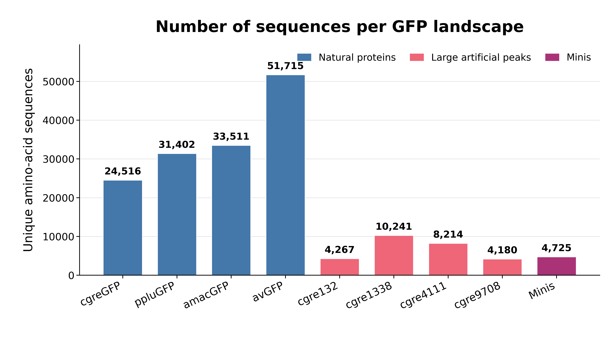

# GFP fluorescence prediction

This repository contains reproducible datasets and models for predicting
**log10 fluorescence from GFP protein sequence**. The project studies natural
GFP orthologs, natural cgreGFP and four artificial cgreGFP fitness peaks. It
also tests how prediction changes when labelled sequences from a new protein
are added to training.

The repository is organized for two audiences:

- **New users:** start with the dataset and quick-start sections below.
- **Project collaborators:** use the [complete experiment catalog](docs/EXPERIMENT_CATALOG.md)
  for every report, figure, protocol and intermediate result.

## Latest results and data statistics

- **[Data statistics and presentation figures](docs/DATA_STATISTICS.md):** sequence counts, reference-sequence identity, fluorescence distributions, and exploratory WT-control rescaling.
- [Extended artificial-peak transferability — results pending](results/extended_peak_transfer_seed42_46/REPORT.md): WT/central/other directions, source-only validation, MLP/CNN, five seeds, three matched training budgets.
- **[Prediction versus training-set size — complete](results/protein_train_size_saturation_seed42_46/REPORT.md):** four proteins, MLP and CNN, five seeds; all 280 fits completed.
- **[cgreGFP acquisition benchmark — complete](results/cgre_active_learning_seed42_44/REPORT.md):** eight sampling strategies, CNN and MLP ensemble, three seeds; all 48 trajectories completed.
- [Joint neural hurdle models](results/hurdle_neural_seed42_46/REPORT.md): existing shared-encoder classifier/regressor results, with matched direct regressors.
- [Proposed library-level AL](docs/LIBRARY_LEVEL_ACTIVE_LEARNING.md): selecting parents and erPCR conditions; a research proposal, not a completed experiment.

[](docs/DATA_STATISTICS.md)

## Start here

**Earlier plate-experiment previews (incomplete, 18 November 2026):**
[14,709 cgreGFP training sequences](results/cross_protein_pool_size_seed42_46/preliminary/README.md) ·
[7,350 cgreGFP training sequences](results/cross_protein_pool_size_cgre7350_seed42_46/preliminary/README.md).
These show available random and acquisition results for Aubin, MLP and CNN;
missing rounds and incomplete seed averages are marked explicitly.

| If you want to… | Open this |
|---|---|
| Find the latest experiment or the pictures plotted most recently | **[Experiment timeline and figure finder](docs/EXPERIMENT_TIMELINE.md)** |
| Understand or share the experimental data | [Data and preprocessing](docs/DATA_AND_BASELINES.md) |
| Reproduce the standard cgreGFP benchmark | [Benchmark results](docs/BENCHMARK_RESULTS.md) |
| Compare transfer among cgreGFP, amacGFP, ppluGFP and avGFP | [Four-protein leave-one-out report](results/ortholog_leave_one_out_seed42_46/RESULTS.md) |
| Predict each GFP after adding its own labelled records to mixtures of the other proteins | [Target-included four-protein results](results/ortholog_target_included_seed42_46/RESULTS.md) |
| Rotate each of four artificial cgreGFP peaks through the central role | [Artificial-peak transfer report and live status](results/artificial_peak_holdout_seed42_46/RESULTS.md) |
| Add labelled target-protein sequences iteratively | [Target-adaptation report](results/target_adaptation_complete_report/README.md) |
| Simulate random or acquisition-selected laboratory plates | [Full cgreGFP pool-size report](results/cross_protein_pool_size_seed42_46/REPORT.md) ([acquisition status](results/cross_protein_pool_size_seed42_46/STATUS.md)) · [7,350-source report](results/cross_protein_pool_size_cgre7350_seed42_46/REPORT.md) ([acquisition status](results/cross_protein_pool_size_cgre7350_seed42_46/STATUS.md)) |
| Compare acquisition strategies on amacGFP | [Preliminary amacGFP AL benchmark status and protocol](results/amac_active_learning_seed42_44/STATUS.md) |
| Compare acquisition strategies on cgreGFP | [Completed cgreGFP AL benchmark](results/cgre_active_learning_seed42_44/REPORT.md) |
| Test where same-protein training data saturate | [Completed four-protein MLP/CNN training-size benchmark](results/protein_train_size_saturation_seed42_46/REPORT.md) |
| Reuse the pool-size code | [Pool-size implementation guide](docs/POOL_SIZE_EXPERIMENT.md) |
| Inspect fluorescence distributions and distribution-aware predictors | [cgreGFP predictor study](results/cgre_predictor_study/REPORT.md) |
| Compare epistatic fractions by mutation count | [cgreGFP, ppluGFP and amacGFP epistasis plot](results/epistasis_by_mutation_count/REPORT.md) |
| Follow the experiments by scientific question | [Experiment catalog](docs/EXPERIMENT_CATALOG.md) |
| Browse every result folder, including archives and incomplete runs | [Complete chronological inventory](docs/EXPERIMENT_TIMELINE.md#complete-result-folder-inventory) |

## Data

### Raw experimental inputs

The versioned input files are in [`data/raw/`](data/raw/). They contain the
original amino-acid and nucleotide genotype tables, fluorescence measurements
and reference FASTA sequences. Files retain their source-specific schemas,
replicates and measurement scales.

Use the raw folder when sharing the original experimental records or auditing
provenance.

### Model-ready dataset

All current benchmarks use the deterministic processed table:

```text
data/processed/baseline_v1/sequences.csv
```

Each row contains the protein background, canonical genotype, complete protein
sequence, log10 fluorescence target, provenance, stable identifiers and a
frozen `train`, `validation` or `test` assignment. Duplicate measurements are
aggregated and rejected source rows are recorded separately.

`baseline_v1` is generated locally and is not committed because the main CSV is
approximately 88 MB. Recreate it from the versioned raw inputs with:

```bash
python scripts/prepare_data.py
```

The generated directory contains:

- `sequences.csv`: 168,046 retained model-ready records;
- `exclusions.csv`: rejected rows and explicit reasons;
- `manifest.json`: input/output hashes, software versions, counts and overlap checks.

The older tables already visible under `data/processed/` are retained for
provenance and legacy analyses. They are not the canonical input for current
models. See [Data and baselines](docs/DATA_AND_BASELINES.md) for column
definitions, landscape counts, scaling and preprocessing validation.

## Experimental design in one page

The project uses several related designs. Their names indicate what is added to
training:

| Design | What changes after the initial fit? | Target sequences added? |
|---|---|---:|
| Supervised baseline | Nothing; one fit on a fixed training set | No |
| Source-pool active learning | The acquisition rule selects more records from the source pool | No |
| Target adaptation | 96 labelled target records are selected and added per round | Yes |
| One-shot target control | 960 randomly sampled target records are added once | Yes |
| Pool-size experiment | Independent models are trained on nested random target subsets of increasing size | Yes |
| Acquisition pool-size experiment | Independent models are trained on cumulative target subsets selected by distance and uncertainty | Yes |

The pool-size experiment is **not active learning**: target order is randomly
frozen before training and no acquisition score is used. Each plotted point is
a new model trained from scratch on the fixed source data plus the cumulative
target subset.

Unless a report explicitly states otherwise:

- test records are frozen before fitting and never enter training, validation
  or acquisition;
- compared methods share the same test records and label budgets;
- multi-seed reports use seeds 42–46;
- plots show mean performance and variability across those seeds;
- machine-readable per-run and summary CSVs accompany the report.

## Main model families

| Display name | Implementation |
|---|---|
| Aubin 1–10–1 | Positional one-hot model with the published 1–10–1 head |
| Linear | Additive positional one-hot regression |
| MLP | Fully connected nonlinear positional one-hot model |
| CNN on OHE | Convolutional model operating on positional one-hot sequences |
| Embedding models | MLP, Ridge or XGBoost on ESM-2 or ProteinBERT representations |

Cross-protein positional models use an explicit reference alignment; alignment
gaps are represented by zero feature vectors. Exact architectures and training
settings are documented in the report linked to each experiment.

## Quick start

```bash
git clone https://github.com/kalininalab/gfp_project.git
cd gfp_project
conda env create -f environment.yml
conda activate gfp-benchmark
python -m unittest discover -s tests -v
python scripts/prepare_data.py
python scripts/train_aubin.py \
  --gene cgreGFP \
  --output results/aubin_cgreGFP_seed42
```

Run commands from the repository root. `prepare_data.py` refuses to overwrite a
non-empty processed directory, protecting an existing frozen dataset.

| Workflow | Instructions |
|---|---|
| Data generation and baseline definitions | [Data and baselines](docs/DATA_AND_BASELINES.md) |
| One-hot, ESM and CNN benchmarks | [Running models](docs/RUNNING_MODELS.md) |
| Non-AL transfer experiments | [Transfer experiments](docs/TRANSFER_EXPERIMENTS.md) |
| Source-pool active learning | [Transfer active learning](docs/TRANSFER_ACTIVE_LEARNING.md) |
| Iterative and one-shot target adaptation | [Target adaptation](docs/TARGET_ADAPTATION.md) |
| Random target-pool size experiments | [Pool-size experiment](docs/POOL_SIZE_EXPERIMENT.md) |
| Manuscript-described 80/20 comparison | [Paper reproduction](docs/PAPER_REPRODUCTION.md) |

The environment is pinned in [`environment.yml`](environment.yml). Full CNN
workloads require an NVIDIA GPU. HTCondor wrappers contain paths for the LSV
cluster and must be adjusted for another installation.

## Repository layout

| Path | Contents |
|---|---|
| `data/raw/` | Versioned experimental inputs and reference sequences |
| `data/processed/baseline_v1/` | Generated canonical model table, exclusions and manifest |
| `scripts/` | Preprocessing, models, training, evaluation and plotting |
| `docs/` | Methods, reproduction instructions and the experiment catalog |
| `results/` | Selected reports, summary tables and publication figures |
| `tests/` | Split, indexing, label-alignment and architecture checks |
| `condor/` | LSV-cluster job descriptions and wrappers |
| `esm_embeddings/` | Generated embedding caches; ignored because of their size |

Large checkpoints, per-fit predictions, Condor logs and generated embeddings
are kept outside Git. Published result directories contain the reports and
machine-readable summaries needed to interpret each figure.
