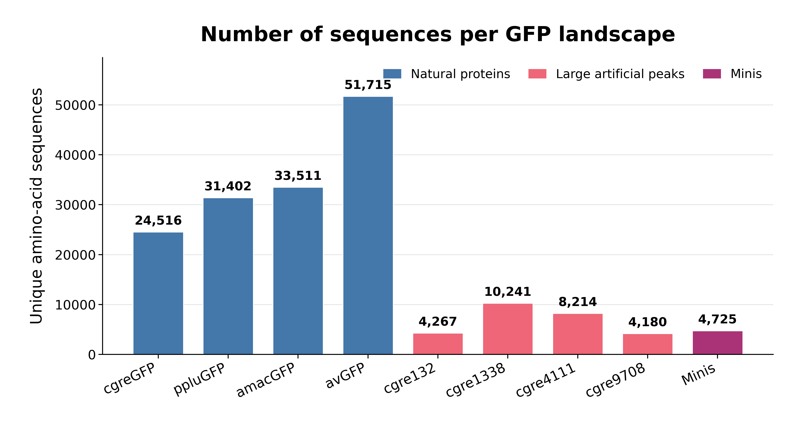
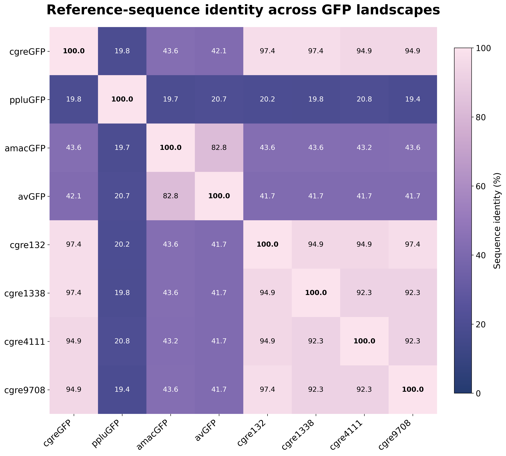
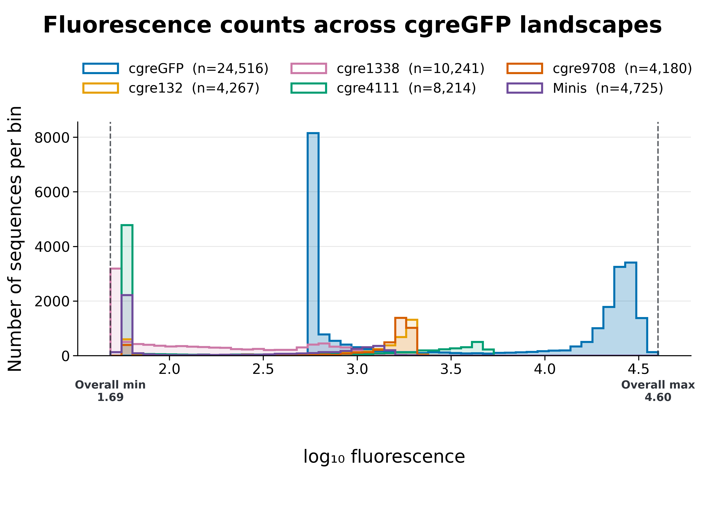
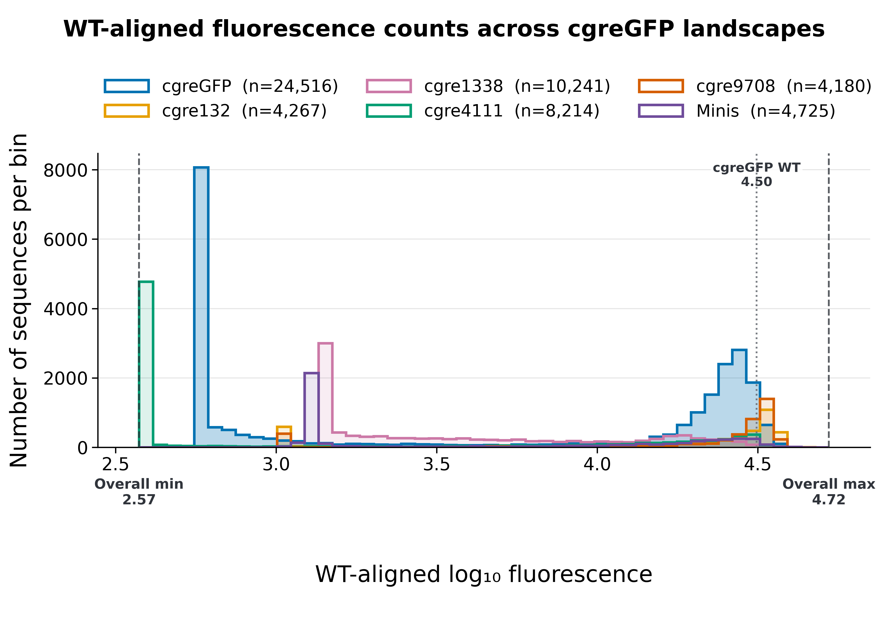

# GFP data statistics and presentation figures

[Back to the project overview](../README.md) · [Data provenance and preprocessing](DATA_AND_BASELINES.md)

This page collects the descriptive figures made alongside the latest experiments. Counts include all retained partitions, not just training records. Figures are available as PNG, PDF and SVG in their linked folders.

## Number of sequences



| Landscape | Retained unique amino-acid sequences |
|---|---:|
| cgreGFP | 24,516 |
| ppluGFP | 31,402 |
| amacGFP | 33,511 |
| avGFP | 51,715 |
| cgre132 | 4,267 |
| cgre1338 | 10,241 |
| cgre4111 | 8,214 |
| cgre9708 | 4,180 |
| Minis, pooled | 4,725 |

[Slide PDF](../results/dataset_sequence_counts/sequence_counts_slide.pdf) · [Count table and methods](../results/dataset_sequence_counts/README.md)

The first eight counts come from canonical `baseline_v1`. Minis are a descriptive addition from the `cgre12minis` raw file, with repeated valid protein sequences pooled; they are **not part of the existing canonical model benchmarks**.

## Reference-sequence identity



Identity compares WT/reference sequences, not all measured mutants. It uses global BLOSUM62 alignment, gap opening −10 and extension −0.5; identical residues are divided by all alignment columns, including gaps.

[Full matrix with 11 Minis landscapes expanded](../results/sequence_identity_all_gfps/sequence_identity_all_landscapes.png) · [Matrices, CSV values and methods](../results/sequence_identity_all_gfps/README.md)

## Fluorescence on the original source scales



[Count PDF](../results/cgre_peak_fluorescence_distributions/cgre_peak_fluorescence_counts.pdf) · [Normalized density](../results/cgre_peak_fluorescence_distributions/cgre_peak_fluorescence_distributions.png) · [Smoothed counts](../results/cgre_peak_fluorescence_distributions/cgre_peak_fluorescence_counts_smooth.png)

Natural cgreGFP uses `log10(replicates_mean_brightness)` from the combined natural-protein amino-acid table. Artificial peaks and Minis use `log10(brightness)` from the `240228__ntdata_*__cgreWTgates.csv` files after pseudocell-count-weighted protein-sequence aggregation. The original count plot uses 50 common bins. Density curves normalize each landscape separately; smoothed counts use KDE × sample count × a 100-bin-equivalent width and are estimates, not exact bin counts.

The observed minimum for natural cgreGFP is 590 (2.77085 in log10 units), shared by 7,814 records. The original pooled minimum and maximum are approximately 1.69 and 4.60 log10 units. A density curve can extend beyond observed bounds because of smoothing. The different lower limits and control values warrant checking calibration before interpreting differences as biological.

## Exploratory rescaling to the natural cgreGFP WT



[WT-aligned count PDF](../results/cgre_peak_fluorescence_distributions/cgre_peak_fluorescence_counts_wt_aligned.pdf) · [WT-aligned density](../results/cgre_peak_fluorescence_distributions/cgre_peak_fluorescence_wt_aligned.png) · [Exact control values and factors](../results/cgre_peak_fluorescence_distributions/wt_alignment_factors.csv)

For each artificial input file, multiply brightness by **natural cgreGFP WT brightness / that file's `wt_ctrl_cgre_wt` brightness**. The natural WT reference is 31,398.87. This produces a file-specific additive shift in log10 space. Natural cgreGFP remains unchanged.

This is an exploratory single-control normalization, not a validated assay recalibration. It cannot resolve background offsets, censoring or nonlinear assay differences. **Existing training datasets and transferability experiments have not been rescaled or rerun.** Results here describe a plotting transformation only.

## Reproduce these figures

From the repository root, after preparing `baseline_v1` and installing the project dependencies:

```bash
python scripts/plot_dataset_sequence_counts.py
python scripts/plot_all_gfp_sequence_identity.py
python scripts/plot_cgre_peak_fluorescence_distributions.py
```

The scripts use the versioned raw data and reference FASTA plus the locally generated canonical table. No model training is needed.
