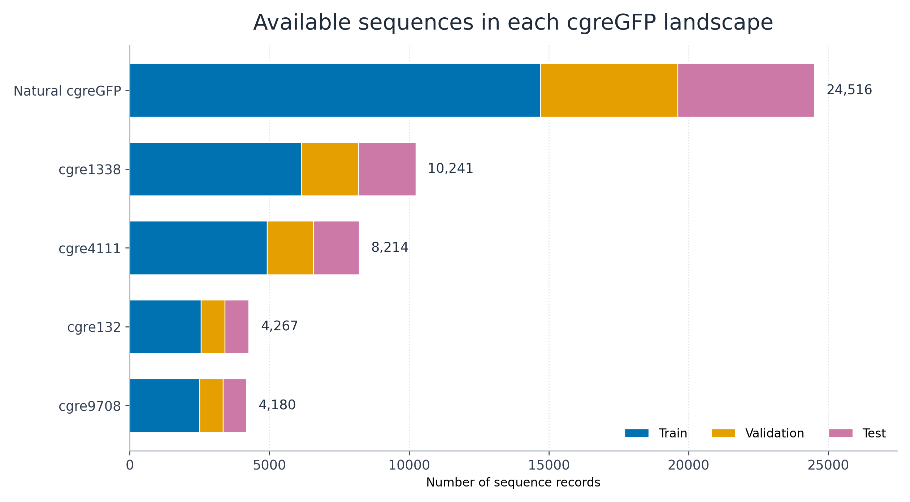
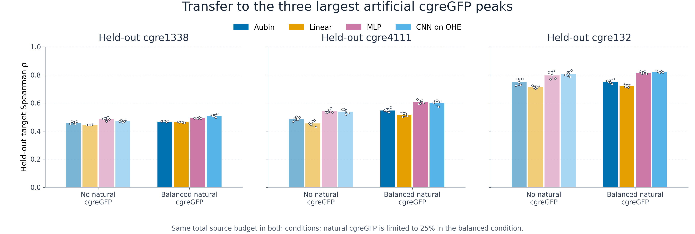
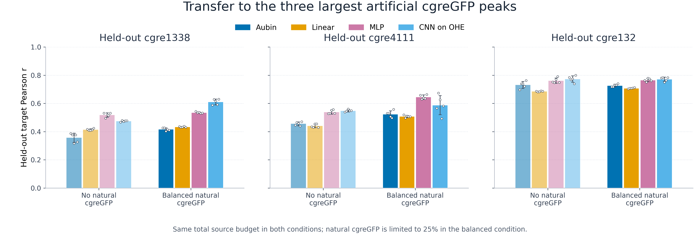
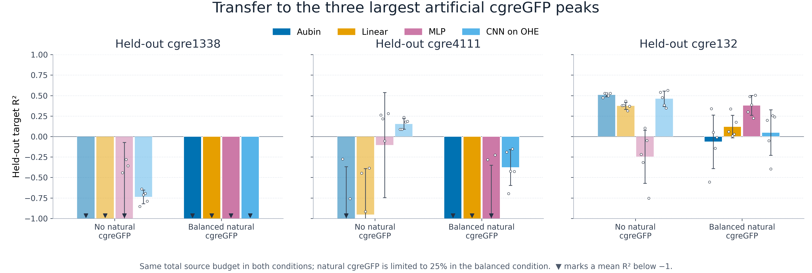

# Transfer to held-out artificial cgreGFP peaks

## Question

Can shotgun landscapes from other cgreGFP peaks predict a non-central artificial peak, and does adding the large natural cgreGFP landscape help?

## Design

The three largest artificial landscapes are tested separately: `cgre1338`, `cgre4111`, and `cgre132`. For each target, the complete target landscape is excluded from training and validation. Its original 20% test partition is the frozen evaluation set.

The artificial sources are explicit below. `cgre9708` is the fourth-largest
artificial landscape, so it is not one of the three requested targets, but it
is included as a source in every comparison:

| Held-out target | Artificial source landscapes |
|---|---|
| `cgre1338` | `cgre132`, `cgre4111`, `cgre9708` |
| `cgre4111` | `cgre132`, `cgre1338`, `cgre9708` |
| `cgre132` | `cgre1338`, `cgre4111`, `cgre9708` |

## Reference-sequence identity

All five reference sequences contain 235 amino acids, so identity is the
percentage of positions containing the same amino acid; no alignment gaps are
required.

| | cgreGFP | cgre132 | cgre1338 | cgre4111 | cgre9708 |
|---|---:|---:|---:|---:|---:|
| **cgreGFP** | 100.00% | 97.45% | 97.45% | 94.89% | 94.89% |
| **cgre132** | 97.45% | 100.00% | 94.89% | 94.89% | 97.45% |
| **cgre1338** | 97.45% | 94.89% | 100.00% | 92.34% | 92.34% |
| **cgre4111** | 94.89% | 94.89% | 92.34% | 100.00% | 92.34% |
| **cgre9708** | 94.89% | 97.45% | 92.34% | 92.34% | 100.00% |

The machine-readable matrix is in `sequence_identity_matrix.csv`.

## Available sequences by landscape

Bars show the complete processed landscape before experiment-specific
subsampling. The much larger natural cgreGFP landscape motivates balancing it
rather than allowing it to dominate the source data. Exact counts are in
`landscape_sizes.csv`.

Both source conditions contain exactly **7,524 training** and **2,508 validation** sequences:

- **No natural cgreGFP:** equal contributions from the other three artificial peaks (2,508 train + 836 validation each).
- **Balanced natural cgreGFP:** equal contributions from the other three artificial peaks and natural cgreGFP (1,881 train + 627 validation each). Natural cgreGFP is therefore 25% of the source data and cannot dominate by sample count.

Five seeds (42–46) change source subsampling, model initialization, and training order. The frozen target test is identical across all models, source conditions, and seeds. Checkpoints are selected only by source-validation MSE.

## Figures

R² is displayed on the requested −1 to 1 axis; exact unclipped values are retained below and in `summary.csv`.

## Results

| Held-out peak | Source condition | Model | Test n | Spearman | Pearson | R² | RMSE |
|---|---|---|---:|---:|---:|---:|---:|
| cgre1338 | Other artificial peaks | Aubin | 2049 | 0.459 ± 0.009 | 0.357 ± 0.033 | -7.316 ± 0.834 | 1.284 ± 0.063 |
| cgre1338 | Other artificial peaks | Linear | 2049 | 0.445 ± 0.003 | 0.414 ± 0.006 | -10.210 ± 2.360 | 1.485 ± 0.163 |
| cgre1338 | Other artificial peaks | MLP | 2049 | 0.485 ± 0.012 | 0.518 ± 0.015 | -1.014 ± 0.942 | 0.620 ± 0.142 |
| cgre1338 | Other artificial peaks | CNN on OHE | 2049 | 0.471 ± 0.007 | 0.474 ± 0.005 | -0.738 ± 0.084 | 0.587 ± 0.014 |
| cgre1338 | Other peaks + natural cgreGFP | Aubin | 2049 | 0.468 ± 0.003 | 0.416 ± 0.011 | -17.770 ± 2.775 | 1.926 ± 0.147 |
| cgre1338 | Other peaks + natural cgreGFP | Linear | 2049 | 0.463 ± 0.003 | 0.433 ± 0.004 | -18.850 ± 1.946 | 1.984 ± 0.099 |
| cgre1338 | Other peaks + natural cgreGFP | MLP | 2049 | 0.492 ± 0.004 | 0.535 ± 0.005 | -11.993 ± 1.801 | 1.604 ± 0.109 |
| cgre1338 | Other peaks + natural cgreGFP | CNN on OHE | 2049 | 0.510 ± 0.010 | 0.610 ± 0.020 | -6.572 ± 1.173 | 1.223 ± 0.095 |
| cgre4111 | Other artificial peaks | Aubin | 1643 | 0.488 ± 0.014 | 0.456 ± 0.013 | -1.113 ± 0.745 | 1.115 ± 0.194 |
| cgre4111 | Other artificial peaks | Linear | 1643 | 0.455 ± 0.019 | 0.441 ± 0.013 | -0.954 ± 0.563 | 1.076 ± 0.156 |
| cgre4111 | Other artificial peaks | MLP | 1643 | 0.543 ± 0.014 | 0.538 ± 0.015 | -0.104 ± 0.641 | 0.793 ± 0.211 |
| cgre4111 | Other artificial peaks | CNN on OHE | 1643 | 0.538 ± 0.016 | 0.548 ± 0.008 | 0.155 ± 0.065 | 0.713 ± 0.027 |
| cgre4111 | Other peaks + natural cgreGFP | Aubin | 1643 | 0.548 ± 0.013 | 0.524 ± 0.024 | -4.902 ± 2.088 | 1.855 ± 0.375 |
| cgre4111 | Other peaks + natural cgreGFP | Linear | 1643 | 0.518 ± 0.015 | 0.508 ± 0.008 | -4.164 ± 1.455 | 1.747 ± 0.266 |
| cgre4111 | Other peaks + natural cgreGFP | MLP | 1643 | 0.607 ± 0.014 | 0.645 ± 0.015 | -1.475 ± 1.125 | 1.192 ± 0.296 |
| cgre4111 | Other peaks + natural cgreGFP | CNN on OHE | 1643 | 0.602 ± 0.017 | 0.588 ± 0.067 | -0.379 ± 0.219 | 0.909 ± 0.072 |
| cgre132 | Other artificial peaks | Aubin | 854 | 0.748 ± 0.023 | 0.731 ± 0.024 | 0.509 ± 0.024 | 0.396 ± 0.010 |
| cgre132 | Other artificial peaks | Linear | 854 | 0.714 ± 0.009 | 0.685 ± 0.003 | 0.375 ± 0.042 | 0.447 ± 0.015 |
| cgre132 | Other artificial peaks | MLP | 854 | 0.797 ± 0.026 | 0.762 ± 0.019 | -0.247 ± 0.325 | 0.627 ± 0.080 |
| cgre132 | Other artificial peaks | CNN on OHE | 854 | 0.808 ± 0.017 | 0.773 ± 0.022 | 0.462 ± 0.095 | 0.413 ± 0.037 |
| cgre132 | Other peaks + natural cgreGFP | Aubin | 854 | 0.751 ± 0.013 | 0.727 ± 0.010 | -0.064 ± 0.327 | 0.578 ± 0.089 |
| cgre132 | Other peaks + natural cgreGFP | Linear | 854 | 0.722 ± 0.010 | 0.707 ± 0.003 | 0.122 ± 0.137 | 0.528 ± 0.043 |
| cgre132 | Other peaks + natural cgreGFP | MLP | 854 | 0.816 ± 0.008 | 0.765 ± 0.011 | 0.381 ± 0.120 | 0.443 ± 0.043 |
| cgre132 | Other peaks + natural cgreGFP | CNN on OHE | 854 | 0.822 ± 0.005 | 0.772 ± 0.015 | 0.048 ± 0.277 | 0.547 ± 0.077 |

Values are mean ± run SD over five seeds. `per_run_scores.csv` contains every repeat; `sample_counts.csv` in the frozen run directory records every source contribution.
