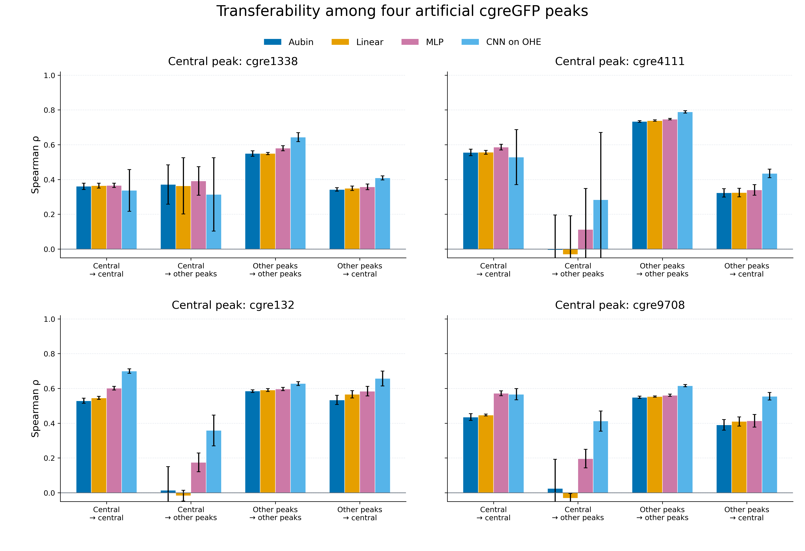
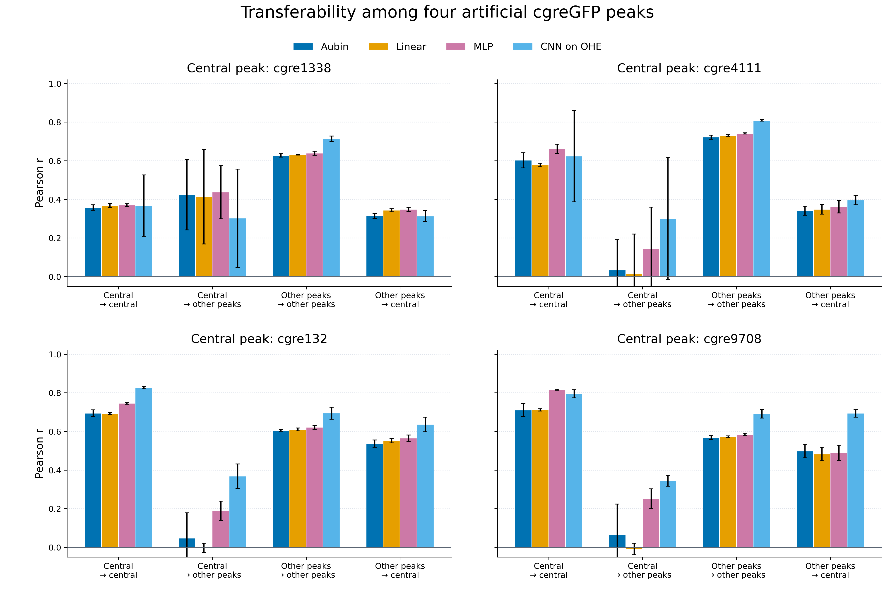
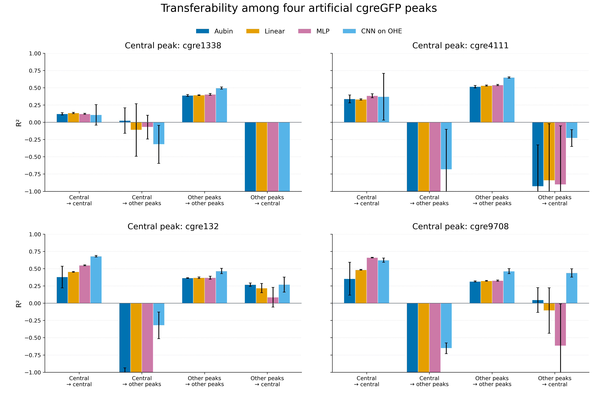

# Rotating-central transfer among artificial cgreGFP peaks

**Corrected design:** natural `cgreGFP` is excluded completely. The four largest artificial landscapes (`cgre1338`, `cgre4111`, `cgre132`, `cgre9708`) take turns as the pseudo-natural central peak. In each panel, the remaining three landscapes form the pooled other-peaks domain.

## Protocol

- Every fit uses **2,508 train** and **836 validation** records.
- The central-source fit uses only the panel’s central peak.
- The other-peaks fit divides the same budget equally among the remaining three peaks.
- Each fit is evaluated on both frozen domains, producing central→central, central→other peaks, other peaks→other peaks and other peaks→central.
- The original 20% tests are frozen. Test labels never enter training, validation, checkpoint selection or subsampling.
- Five seeds (42–46) vary source subsampling, initialization and training order. Bars show mean ± run SD.
- Models are Aubin, linear regression on OHE, MLP and CNN on OHE.

The common source budget is set by the smallest landscape (`cgre9708`). This prevents peak size from changing when the designated central peak rotates. Exact source contributions are in `sample_counts.csv`.

## Figures

R² is displayed on [−1, 1]; exact unclipped values are in the tables.

## Main result

Within-domain prediction is consistently stronger than transfer from a single central peak to the pooled other peaks. CNN on OHE gives the strongest cross-domain rank correlation in most rotations, especially when `cgre4111`, `cgre132` or `cgre9708` is central. Positive rank correlations can coexist with negative R² because a model may order variants partly correctly while missing the target landscape’s fluorescence level and scale.

## Results

| Central peak | Direction | Model | Test n | Spearman | Pearson | R² | RMSE |
|---|---|---|---:|---:|---:|---:|---:|
| cgre1338 | Central → central | Aubin | 2049 | 0.360 ± 0.018 | 0.357 ± 0.015 | 0.121 ± 0.017 | 0.418 ± 0.004 |
| cgre1338 | Central → central | Linear | 2049 | 0.364 ± 0.014 | 0.367 ± 0.011 | 0.133 ± 0.009 | 0.415 ± 0.002 |
| cgre1338 | Central → central | MLP | 2049 | 0.366 ± 0.013 | 0.370 ± 0.008 | 0.121 ± 0.008 | 0.418 ± 0.002 |
| cgre1338 | Central → central | CNN on OHE | 2049 | 0.337 ± 0.120 | 0.367 ± 0.159 | 0.107 ± 0.148 | 0.420 ± 0.036 |
| cgre1338 | Central → other peaks | Aubin | 3333 | 0.371 ± 0.113 | 0.424 ± 0.183 | 0.025 ± 0.184 | 0.714 ± 0.064 |
| cgre1338 | Central → other peaks | Linear | 3333 | 0.363 ± 0.162 | 0.413 ± 0.244 | -0.112 ± 0.380 | 0.757 ± 0.121 |
| cgre1338 | Central → other peaks | MLP | 3333 | 0.391 ± 0.082 | 0.436 ± 0.137 | -0.071 ± 0.172 | 0.749 ± 0.060 |
| cgre1338 | Central → other peaks | CNN on OHE | 3333 | 0.314 ± 0.211 | 0.302 ± 0.255 | -0.321 ± 0.274 | 0.830 ± 0.090 |
| cgre1338 | Other peaks → other peaks | Aubin | 3333 | 0.549 ± 0.016 | 0.627 ± 0.009 | 0.388 ± 0.013 | 0.568 ± 0.006 |
| cgre1338 | Other peaks → other peaks | Linear | 3333 | 0.549 ± 0.007 | 0.631 ± 0.001 | 0.393 ± 0.005 | 0.565 ± 0.002 |
| cgre1338 | Other peaks → other peaks | MLP | 3333 | 0.580 ± 0.015 | 0.639 ± 0.010 | 0.403 ± 0.013 | 0.560 ± 0.006 |
| cgre1338 | Other peaks → other peaks | CNN on OHE | 3333 | 0.643 ± 0.026 | 0.713 ± 0.014 | 0.495 ± 0.015 | 0.515 ± 0.008 |
| cgre1338 | Other peaks → central | Aubin | 2049 | 0.342 ± 0.010 | 0.314 ± 0.013 | -10.383 ± 2.585 | 1.496 ± 0.171 |
| cgre1338 | Other peaks → central | Linear | 2049 | 0.349 ± 0.013 | 0.344 ± 0.008 | -9.903 ± 2.418 | 1.463 ± 0.177 |
| cgre1338 | Other peaks → central | MLP | 2049 | 0.357 ± 0.016 | 0.348 ± 0.011 | -11.035 ± 2.919 | 1.536 ± 0.201 |
| cgre1338 | Other peaks → central | CNN on OHE | 2049 | 0.409 ± 0.012 | 0.313 ± 0.029 | -2.880 ± 0.686 | 0.875 ± 0.076 |
| cgre4111 | Central → central | Aubin | 1643 | 0.556 ± 0.019 | 0.602 ± 0.039 | 0.338 ± 0.057 | 0.631 ± 0.027 |
| cgre4111 | Central → central | Linear | 1643 | 0.556 ± 0.011 | 0.577 ± 0.010 | 0.330 ± 0.011 | 0.635 ± 0.005 |
| cgre4111 | Central → central | MLP | 1643 | 0.585 ± 0.016 | 0.661 ± 0.024 | 0.383 ± 0.029 | 0.609 ± 0.014 |
| cgre4111 | Central → central | CNN on OHE | 1643 | 0.528 ± 0.159 | 0.623 ± 0.237 | 0.369 ± 0.339 | 0.599 ± 0.163 |
| cgre4111 | Central → other peaks | Aubin | 3739 | -0.006 ± 0.202 | 0.034 ± 0.157 | -7.405 ± 4.639 | 1.752 ± 0.498 |
| cgre4111 | Central → other peaks | Linear | 3739 | -0.032 ± 0.223 | 0.015 ± 0.206 | -4.588 ± 2.091 | 1.455 ± 0.260 |
| cgre4111 | Central → other peaks | MLP | 3739 | 0.112 ± 0.236 | 0.146 ± 0.214 | -19.429 ± 10.325 | 2.737 ± 0.749 |
| cgre4111 | Central → other peaks | CNN on OHE | 3739 | 0.284 ± 0.387 | 0.301 ± 0.316 | -0.682 ± 0.579 | 0.798 ± 0.145 |
| cgre4111 | Other peaks → other peaks | Aubin | 3739 | 0.733 ± 0.005 | 0.722 ± 0.010 | 0.515 ± 0.018 | 0.434 ± 0.008 |
| cgre4111 | Other peaks → other peaks | Linear | 3739 | 0.738 ± 0.004 | 0.730 ± 0.004 | 0.531 ± 0.007 | 0.427 ± 0.003 |
| cgre4111 | Other peaks → other peaks | MLP | 3739 | 0.747 ± 0.004 | 0.741 ± 0.003 | 0.539 ± 0.009 | 0.423 ± 0.004 |
| cgre4111 | Other peaks → other peaks | CNN on OHE | 3739 | 0.789 ± 0.007 | 0.809 ± 0.005 | 0.648 ± 0.010 | 0.370 ± 0.005 |
| cgre4111 | Other peaks → central | Aubin | 1643 | 0.323 ± 0.025 | 0.341 ± 0.024 | -0.929 ± 0.601 | 1.067 ± 0.172 |
| cgre4111 | Other peaks → central | Linear | 1643 | 0.325 ± 0.024 | 0.348 ± 0.025 | -0.844 ± 0.823 | 1.034 ± 0.227 |
| cgre4111 | Other peaks → central | MLP | 1643 | 0.340 ± 0.031 | 0.361 ± 0.032 | -0.902 ± 0.849 | 1.047 ± 0.248 |
| cgre4111 | Other peaks → central | CNN on OHE | 1643 | 0.434 ± 0.025 | 0.396 ± 0.025 | -0.229 ± 0.121 | 0.860 ± 0.042 |
| cgre132 | Central → central | Aubin | 854 | 0.529 ± 0.015 | 0.694 ± 0.017 | 0.379 ± 0.157 | 0.443 ± 0.055 |
| cgre132 | Central → central | Linear | 854 | 0.545 ± 0.009 | 0.692 ± 0.005 | 0.453 ± 0.005 | 0.418 ± 0.002 |
| cgre132 | Central → central | MLP | 854 | 0.601 ± 0.011 | 0.745 ± 0.004 | 0.548 ± 0.007 | 0.380 ± 0.003 |
| cgre132 | Central → central | CNN on OHE | 854 | 0.699 ± 0.013 | 0.827 ± 0.006 | 0.679 ± 0.011 | 0.320 ± 0.005 |
| cgre132 | Central → other peaks | Aubin | 4528 | 0.014 ± 0.135 | 0.046 ± 0.131 | -2.440 ± 1.503 | 1.212 ± 0.288 |
| cgre132 | Central → other peaks | Linear | 4528 | -0.017 ± 0.031 | -0.003 ± 0.024 | -2.859 ± 0.181 | 1.312 ± 0.031 |
| cgre132 | Central → other peaks | MLP | 4528 | 0.174 ± 0.053 | 0.189 ± 0.050 | -2.951 ± 0.518 | 1.325 ± 0.088 |
| cgre132 | Central → other peaks | CNN on OHE | 4528 | 0.358 ± 0.088 | 0.368 ± 0.063 | -0.322 ± 0.193 | 0.766 ± 0.057 |
| cgre132 | Other peaks → other peaks | Aubin | 4528 | 0.585 ± 0.007 | 0.605 ± 0.004 | 0.363 ± 0.005 | 0.533 ± 0.002 |
| cgre132 | Other peaks → other peaks | Linear | 4528 | 0.590 ± 0.008 | 0.610 ± 0.007 | 0.368 ± 0.011 | 0.531 ± 0.005 |
| cgre132 | Other peaks → other peaks | MLP | 4528 | 0.597 ± 0.009 | 0.621 ± 0.010 | 0.368 ± 0.021 | 0.531 ± 0.009 |
| cgre132 | Other peaks → other peaks | CNN on OHE | 4528 | 0.628 ± 0.011 | 0.695 ± 0.031 | 0.465 ± 0.038 | 0.488 ± 0.017 |
| cgre132 | Other peaks → central | Aubin | 854 | 0.534 ± 0.027 | 0.537 ± 0.019 | 0.268 ± 0.024 | 0.483 ± 0.008 |
| cgre132 | Other peaks → central | Linear | 854 | 0.566 ± 0.021 | 0.551 ± 0.012 | 0.218 ± 0.067 | 0.500 ± 0.021 |
| cgre132 | Other peaks → central | MLP | 854 | 0.584 ± 0.028 | 0.565 ± 0.017 | 0.086 ± 0.142 | 0.539 ± 0.043 |
| cgre132 | Other peaks → central | CNN on OHE | 854 | 0.657 ± 0.043 | 0.636 ± 0.038 | 0.269 ± 0.108 | 0.482 ± 0.036 |
| cgre9708 | Central → central | Aubin | 836 | 0.435 ± 0.020 | 0.711 ± 0.033 | 0.353 ± 0.237 | 0.351 ± 0.064 |
| cgre9708 | Central → central | Linear | 836 | 0.447 ± 0.005 | 0.711 ± 0.005 | 0.483 ± 0.005 | 0.318 ± 0.002 |
| cgre9708 | Central → central | MLP | 836 | 0.572 ± 0.014 | 0.816 ± 0.002 | 0.659 ± 0.004 | 0.258 ± 0.002 |
| cgre9708 | Central → central | CNN on OHE | 836 | 0.566 ± 0.032 | 0.795 ± 0.022 | 0.622 ± 0.030 | 0.272 ± 0.011 |
| cgre9708 | Central → other peaks | Aubin | 4546 | 0.025 ± 0.167 | 0.065 ± 0.158 | -3.229 ± 2.091 | 1.325 ± 0.362 |
| cgre9708 | Central → other peaks | Linear | 4546 | -0.032 ± 0.026 | -0.009 ± 0.030 | -4.794 ± 0.300 | 1.596 ± 0.041 |
| cgre9708 | Central → other peaks | MLP | 4546 | 0.196 ± 0.053 | 0.252 ± 0.050 | -1.826 ± 0.675 | 1.109 ± 0.129 |
| cgre9708 | Central → other peaks | CNN on OHE | 4546 | 0.412 ± 0.058 | 0.345 ± 0.028 | -0.653 ± 0.078 | 0.852 ± 0.020 |
| cgre9708 | Other peaks → other peaks | Aubin | 4546 | 0.549 ± 0.007 | 0.567 ± 0.010 | 0.314 ± 0.008 | 0.549 ± 0.003 |
| cgre9708 | Other peaks → other peaks | Linear | 4546 | 0.553 ± 0.003 | 0.572 ± 0.004 | 0.323 ± 0.006 | 0.546 ± 0.002 |
| cgre9708 | Other peaks → other peaks | MLP | 4546 | 0.561 ± 0.006 | 0.584 ± 0.006 | 0.326 ± 0.009 | 0.545 ± 0.004 |
| cgre9708 | Other peaks → other peaks | CNN on OHE | 4546 | 0.616 ± 0.006 | 0.692 ± 0.023 | 0.463 ± 0.036 | 0.486 ± 0.016 |
| cgre9708 | Other peaks → central | Aubin | 836 | 0.390 ± 0.030 | 0.498 ± 0.035 | 0.046 ± 0.178 | 0.430 ± 0.040 |
| cgre9708 | Other peaks → central | Linear | 836 | 0.410 ± 0.026 | 0.483 ± 0.035 | -0.108 ± 0.329 | 0.462 ± 0.066 |
| cgre9708 | Other peaks → central | MLP | 836 | 0.413 ± 0.036 | 0.489 ± 0.039 | -0.617 ± 0.606 | 0.555 ± 0.102 |
| cgre9708 | Other peaks → central | CNN on OHE | 836 | 0.555 ± 0.021 | 0.694 ± 0.019 | 0.438 ± 0.060 | 0.331 ± 0.018 |

The former, incorrectly interpreted experiment is retained under [`archive_previous_interpretation/`](archive_previous_interpretation/).
