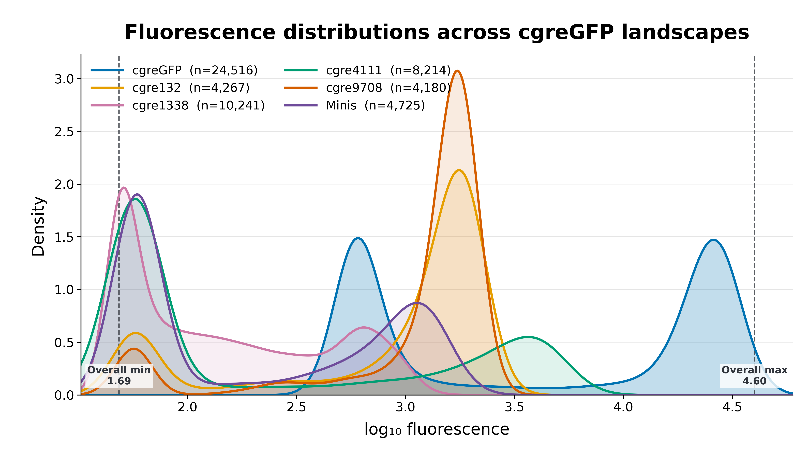

# Fluorescence distributions across cgreGFP landscapes

The curves show kernel-density estimates of model-ready log10 fluorescence for natural cgreGFP, each of the four large artificial peaks, and all smaller artificial landscapes pooled as `Minis`. Repeated Minis amino-acid sequences are aggregated with the same pseudocell-count-weighted arithmetic mean used for the large peaks before log10 transformation. Curve area is normalized separately for each landscape, so shapes are comparable despite different sample counts.
