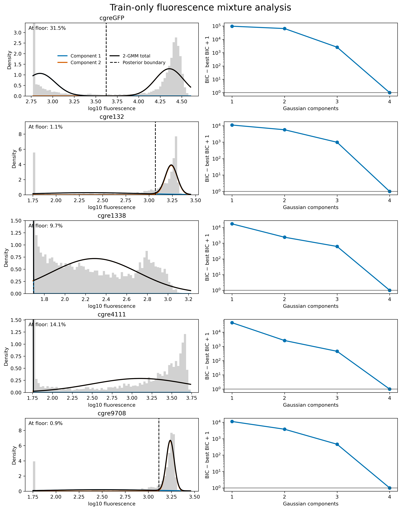
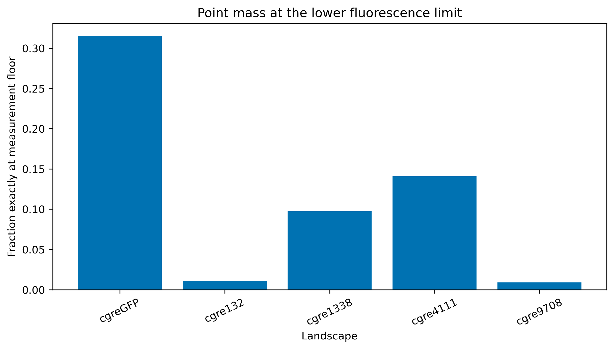

# Fluorescence distributions in natural cgreGFP and artificial peaks

This analysis uses development records (`train` + `validation`) only. The frozen test records are excluded from mixture selection, threshold estimation and every plotted density.

## Main result

A two-Gaussian description is much better than a single Gaussian, but it is not the best model for any landscape among the tested 1–4 component models. BIC and AIC prefer four components in all five full development sets; this does not establish that four is the true number of biological states. Five seeded bootstrap refits give the selected component counts shown below.

| Landscape | Development N | Frozen test excluded | Exact floor fraction | 2-GMM boundary | Bootstrap BIC choices |
|---|---:|---:|---:|---:|---|
| cgreGFP | 19,612 | 4,904 | 31.5% | 3.622 | 4 |
| cgre132 | 3,413 | 854 | 1.1% | 3.068 | 4 |
| cgre1338 | 8,192 | 2,049 | 9.7% | 1.696 | 4 |
| cgre4111 | 6,571 | 1,643 | 14.1% | 1.761 | 4 |
| cgre9708 | 3,344 | 836 | 0.9% | 3.114 | 4 |





The second plot shows the fraction of development-set sequences recorded at exactly the lowest fluorescence value in that landscape. These records form a discrete spike: they may be truly nonfluorescent, or their fluorescence may simply be below the assay's resolution. For example, 31.5% of natural cgreGFP records are at the floor, compared with about 1% for cgre132 and cgre9708.

## What AIC and BIC mean

A Gaussian mixture represents the fluorescence histogram with several bell-shaped curves. Adding curves always makes the training fit more flexible, so we use AIC and BIC to penalize unnecessary complexity. **Lower AIC/BIC is better.** These scores only compare the candidate models fitted to the same data; they are not prediction accuracy, and selecting four among the tested 1–4 components does not prove that four biological states exist.

## Interpretation

The data contain a discrete pile-up at the lower measurement limit plus structured continuous fluorescence above it. Ordinary GMMs approximate that point mass with a nearly zero-variance Gaussian and then divide the continuous part into additional components. Consequently, `dark versus bright` is a useful prediction task, but the observations do not support a literal claim that fluorescence is generated by exactly two Gaussian populations.

A **hurdle model** handles this spike and the continuous values as two linked prediction tasks. First, a classifier estimates the probability `p` that a sequence is above the measurement floor. Second, a regressor estimates its fluorescence `bright_prediction` conditional on being above the floor. The soft-hurdle output is `prediction = (1 - p) × floor + p × bright_prediction`. Thus an uncertain sequence receives a value between the floor and the conditional brightness prediction, rather than being forced into a hard dark/bright class. For example, with floor 2, bright prediction 5 and `p = 0.8`, the final prediction is 4.4.

This construction is most relevant when the point mass is large, as in natural cgreGFP. It may add little when almost no observations are at the floor. A soft two-Gaussian model should still be evaluated as a comparison, using the train-only boundaries in this report, but it should not define the biological ground truth.

## Reproduce

```bash
/nethome/akolchina/miniconda3/envs/combi/bin/python -m scripts.mixture_analysis.analyze
```

Machine-readable outputs: [model selection](model_selection.csv), [two-component summaries](two_component_summary.csv), and [bootstrap stability](bootstrap_stability.csv).
