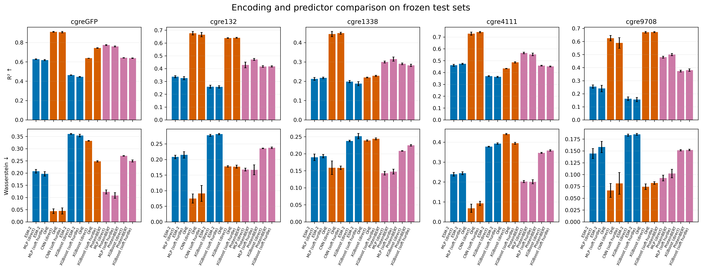
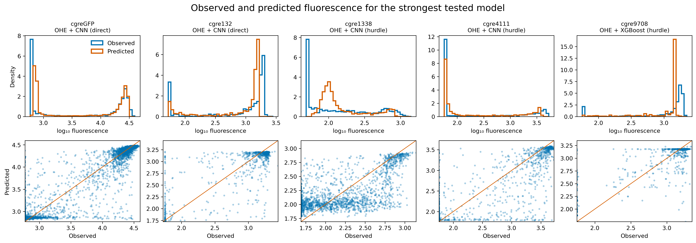
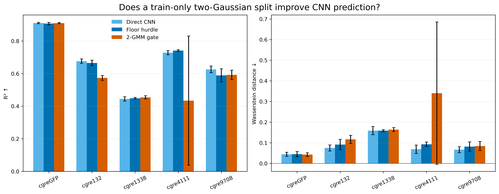

# cgreGFP landscape distributions and predictor comparison

## Executive summary

This study first asks whether the fluorescence values form two clean Gaussian groups. It then tests whether pretrained protein encodings improve prediction when the data split and downstream models are held constant. Finally, it tests whether replacing the exact-floor hurdle with a broader low/high boundary inferred from a two-component GMM improves the strongest CNN predictor. It does not improve prediction consistently, so the direct CNN remains the default.

## Part 1 — What does the fluorescence distribution look like?

The [distribution analysis](../cgre_peak_mixture_analysis/REPORT.md) fits one to four Gaussian components. The criteria are $\mathrm{AIC}=2k-2\ln(\hat L)$ and $\mathrm{BIC}=k\ln(n)-2\ln(\hat L)$, where $\hat L$ is the fitted model's maximum likelihood, $k$ is its number of fitted parameters and $n$ is the number of observations. A one-dimensional $m$-component GMM has $k=3m-1$ parameters: $m-1$ independent weights, $m$ means and $m$ variances. Lower AIC/BIC is better. Both criteria prefer four components over two for every tested landscape. This means that two Gaussians are too simple as a statistical description. It does not prove four biological states, because the assay floor creates a spike that is not Gaussian.

A **hurdle model** treats the spike at the measurement floor and the continuous fluorescence above it as two linked prediction tasks. A classifier estimates `p`, the probability that a sequence is above the floor. A regressor estimates `bright_prediction`, its fluorescence conditional on being above the floor. The soft-hurdle output is `prediction = (1 - p) × floor + p × bright_prediction`. For example, if the floor is 2, the conditional prediction is 5 and `p = 0.8`, the final prediction is 4.4. This probability weighting avoids forcing uncertain sequences into a hard dark/bright class.

Every soft-hurdle result below is compared with a direct regressor using the same encoding, split and seed. The hurdle construction is expected to help most when many observations are at the floor; it may add little where the floor fraction is close to zero.

## Part 2 — Do ProteinBERT encodings improve prediction?

### Design

- Five landscapes: natural cgreGFP and four artificial peak datasets.
- Existing frozen 60% train / 20% validation / 20% test splits; the test records are never used for fitting or early stopping.
- Five seeds (42–46). Error bars are standard deviations across seeds.
- Encodings: 512-dimensional final ProteinBERT global state, 640-dimensional mean ESM-2 state, and positional one-hot sequence.
- Predictors: MLP, XGBoost and the current CNN-on-OHE reference. Each is evaluated as direct regression and soft hurdle.
- Main accuracy metric: R² (higher is better). Distribution metric: Wasserstein distance in log₁₀-fluorescence units (lower is better). Pearson, Spearman, RMSE and Jensen–Shannon divergence are retained in the CSV.

### Best mean R² in each landscape

| Landscape | Encoding | Predictor | Form | R² | Pearson | Wasserstein |
|---|---|---|---|---:|---:|---:|
| cgreGFP | OHE | CNN | direct | 0.910 ± 0.004 | 0.954 ± 0.002 | 0.044 ± 0.010 |
| cgre132 | OHE | CNN | direct | 0.676 ± 0.014 | 0.826 ± 0.007 | 0.075 ± 0.015 |
| cgre1338 | OHE | CNN | hurdle | 0.449 ± 0.005 | 0.675 ± 0.006 | 0.159 ± 0.005 |
| cgre4111 | OHE | CNN | hurdle | 0.741 ± 0.005 | 0.863 ± 0.004 | 0.093 ± 0.011 |
| cgre9708 | OHE | XGBoost | hurdle | 0.672 ± 0.004 | 0.823 ± 0.002 | 0.082 ± 0.003 |

### How to read the metrics

R² measures explained squared error: 1 is perfect, 0 matches predicting the test mean, and negative values are worse. Pearson measures linear agreement and Spearman measures rank agreement. RMSE reports typical error in log₁₀ fluorescence. Wasserstein distance measures the average horizontal movement needed to align the predicted and observed distributions, in the same units as the target. Jensen–Shannon divergence is a bounded, symmetric histogram comparison; 0 means identical distributions.

Machine-readable results: [all seeded metrics](all_metrics.csv) and [five-seed summary](summary.csv). ProteinBERT embeddings and the 192 MB checkpoint live under `/data/users/akolchina`, outside Git.

## Part 3 — Does a broader GMM-defined low-fluorescence class help?

### Motivation and design

The exact-floor hurdle has very few positive examples for some landscapes: only 0.66% of cgre132 and 0.88% of cgre9708 training records are exactly at the measurement floor. We therefore tested the proposed broader split into low- and high-fluorescence groups. For every landscape and seed, a two-component GMM was fitted to the **training labels only**, and the intersection of its weighted Gaussian densities defined the boundary. This classified 24–57% of the training examples as low fluorescence, depending on the landscape and seed.

The sequence model is a CNN on positional OHE with a shared backbone and three outputs: a probability of belonging to the high group, a low-fluorescence regression expert and a high-fluorescence regression expert. Its soft prediction is

`prediction = (1 - p_high) × low_prediction + p_high × high_prediction`.

The direct CNN, exact-floor-hurdle CNN and GMM-gated CNN use the same frozen splits and seeds 42–46. The GMM boundary never sees validation or test labels.

### Frozen-test results

| Landscape | Direct CNN R² | Floor-hurdle CNN R² | 2-GMM-gated CNN R² | 2-GMM-gated Pearson |
|---|---:|---:|---:|---:|
| cgreGFP | **0.910 ± 0.004** | 0.907 ± 0.007 | 0.909 ± 0.004 | 0.954 ± 0.002 |
| cgre132 | **0.676 ± 0.014** | 0.665 ± 0.017 | 0.573 ± 0.015 | 0.760 ± 0.009 |
| cgre1338 | 0.444 ± 0.013 | 0.449 ± 0.005 | **0.454 ± 0.009** | 0.679 ± 0.004 |
| cgre4111 | 0.728 ± 0.013 | **0.741 ± 0.005** | 0.434 ± 0.396 | 0.650 ± 0.280 |
| cgre9708 | **0.625 ± 0.021** | 0.589 ± 0.040 | 0.592 ± 0.029 | 0.774 ± 0.021 |

The broader low-fluorescence class is statistically easier to populate, but it does not make the sequence predictor better in general. It matches the direct CNN on cgreGFP and gives a small R² increase on cgre1338, but it loses accuracy on cgre132 and cgre9708 and is highly unstable on cgre4111. This shows that a visually plausible division of the marginal fluorescence distribution is not necessarily a useful decision boundary in sequence space. The direct CNN remains the recommended default; the GMM gate is retained as a documented negative result rather than selected as the production predictor.

Full outputs: [experiment report](../gmm_gated_cnn_seed42_46/REPORT.md), [five-seed summary](../gmm_gated_cnn_seed42_46/summary.csv), [all seeded metrics](../gmm_gated_cnn_seed42_46/all_metrics.csv), [train-only thresholds](../gmm_gated_cnn_seed42_46/thresholds.csv), and [gate-classifier metrics](../gmm_gated_cnn_seed42_46/classifier_metrics.csv).
