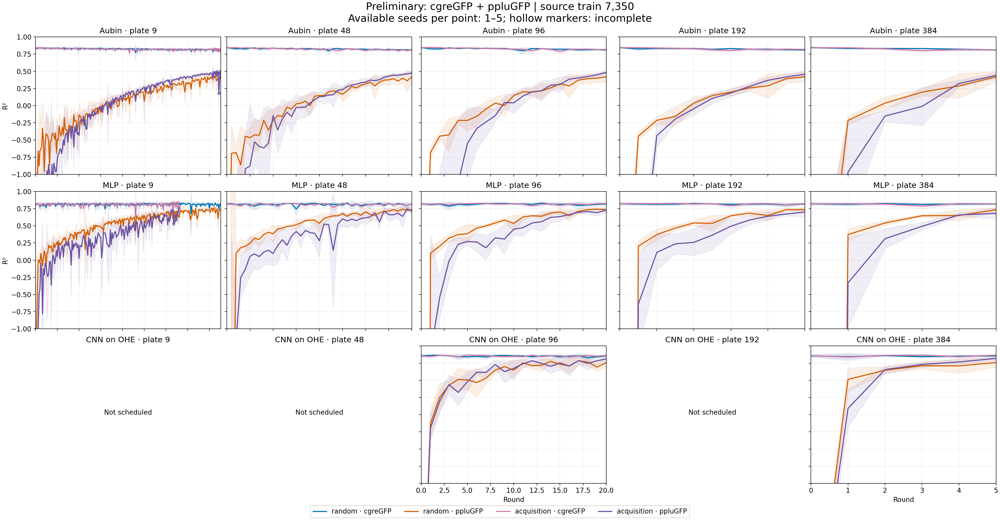
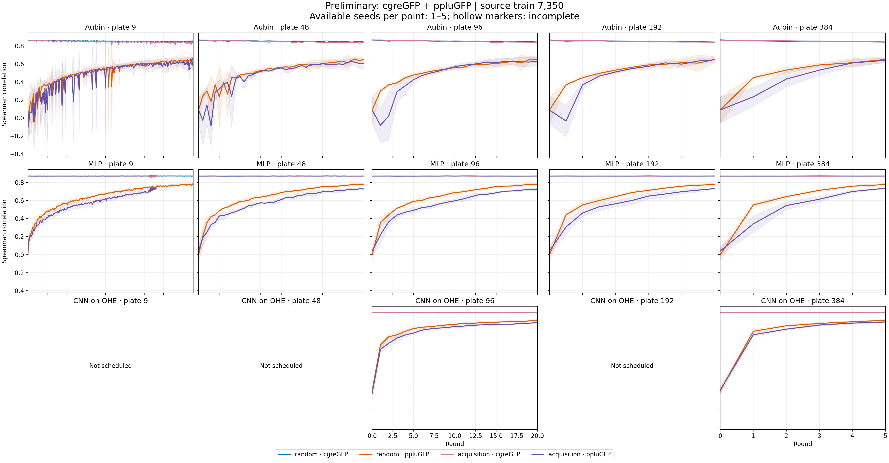
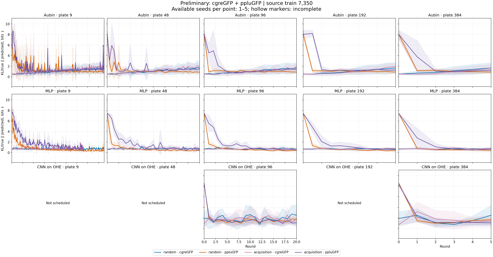
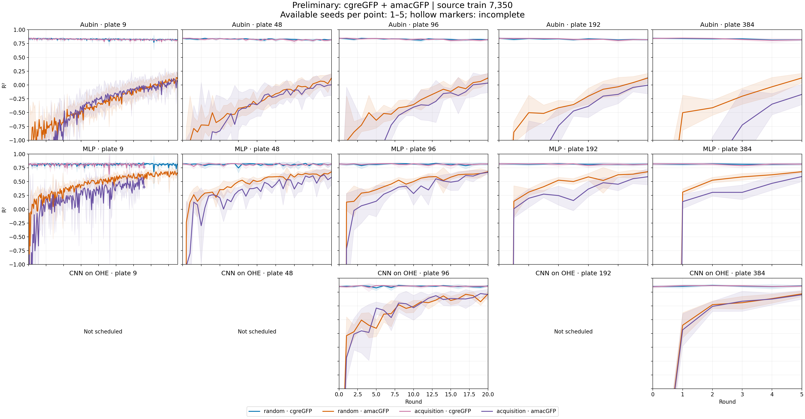
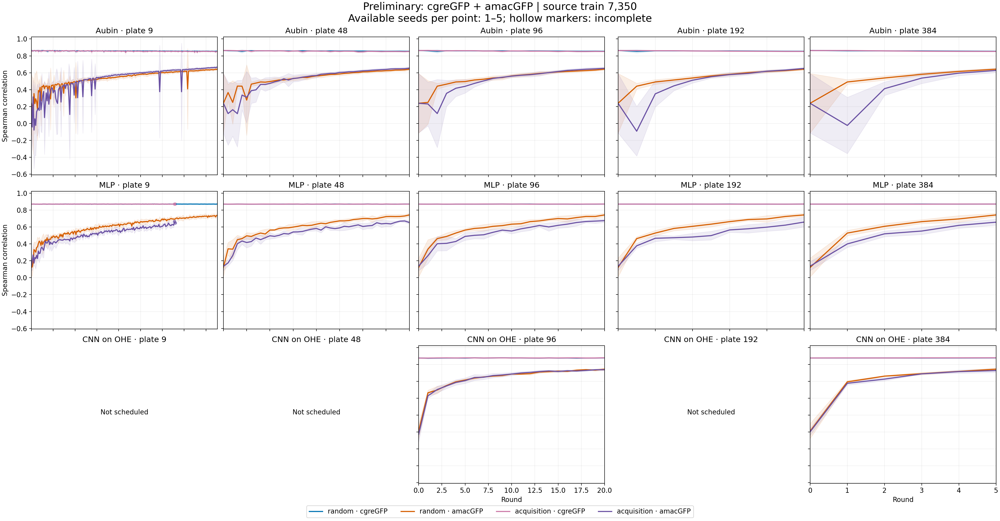
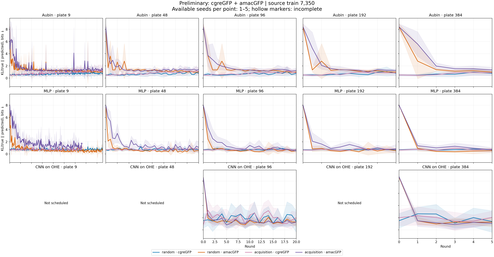

# Preliminary laboratory plate results

Snapshot: 19 November 2026, 10:57 CET. Source training size: 7,350.

**Incomplete experiment.** Each point averages only its available seeds (1–5); hollow points have fewer than five. Shading is ±1 sample SD where at least two seeds exist. Missing rounds are gaps. Changing seed composition can affect the curves; do not treat these as final matched five-seed comparisons. Exact seed counts are in [summary.csv](summary.csv).

Each plate adds target training sequences cumulatively. Models are retrained from new initialization. No target validation labels are used; the source validation set is diagnostic only. Both protein test sets stay frozen. CNN is restricted to plates 96 and 384.

| Sampling | Model | Completed fits/rounds | Total |
|---|---|---:|---:|
| random | Aubin | 2410 | 2410 |
| acquisition | Aubin | 2917 | 2930 |
| random | MLP | 2410 | 2410 |
| acquisition | MLP | 2408 | 2930 |
| random | CNN on OHE | 210 | 210 |
| acquisition | CNN on OHE | 270 | 270 |

Blue/orange: random sampling, source/target test. Pink/violet: acquisition sampling, source/target test. Acquisition combines 0.62 scaled hidden-space distance and 0.38 scaled predictive variance.

## ppluGFP: R²

## ppluGFP: Spearman correlation

## ppluGFP: KL(true || predicted), bits ↓

## amacGFP: R²

## amacGFP: Spearman correlation

## amacGFP: KL(true || predicted), bits ↓

