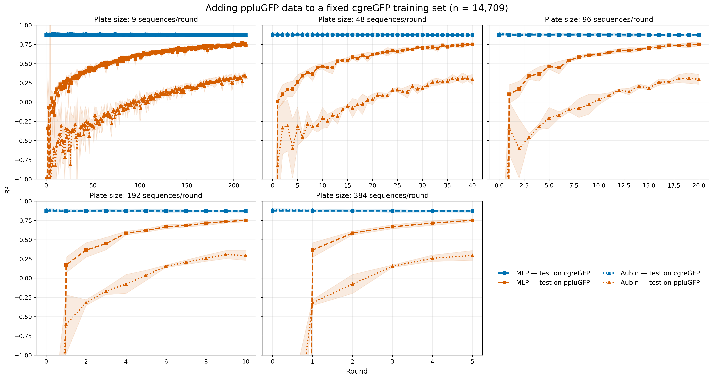
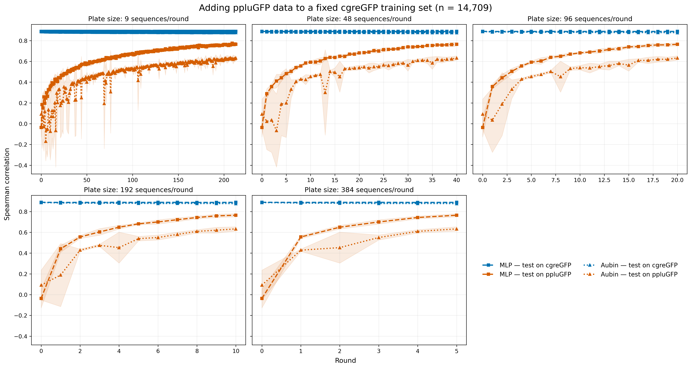
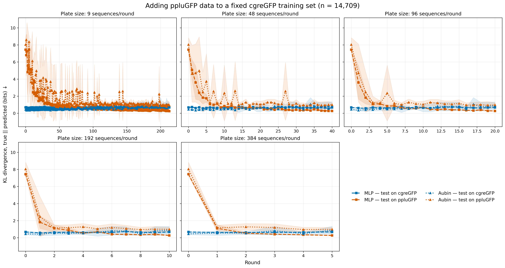
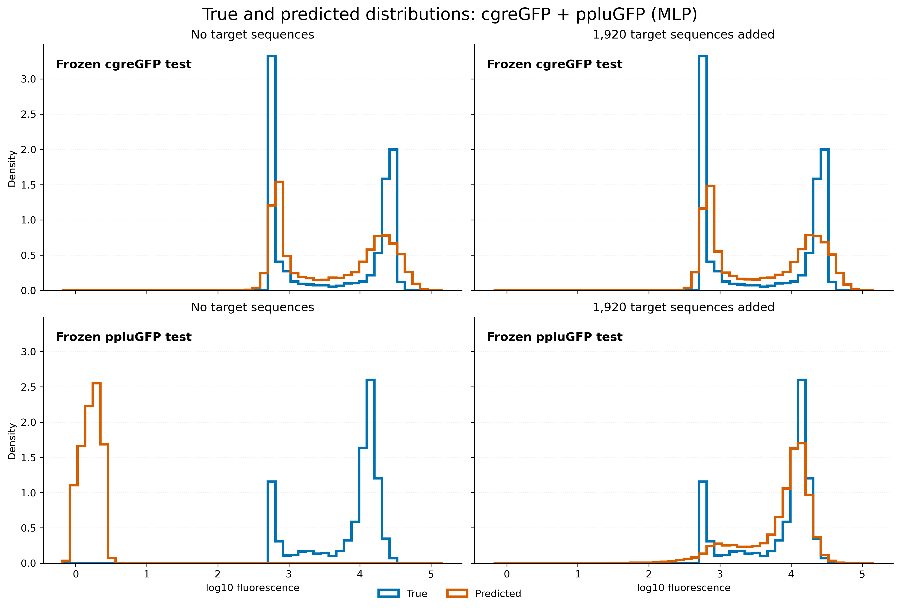
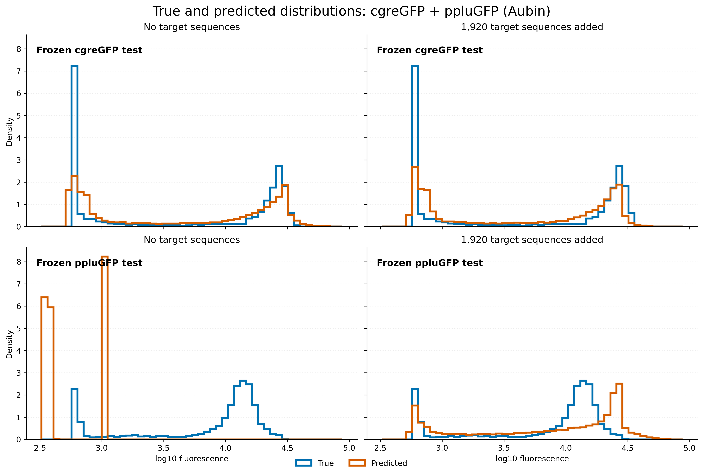
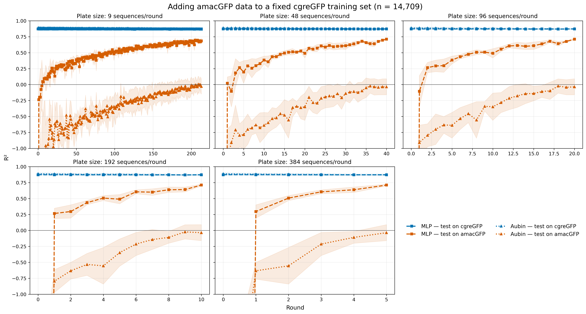
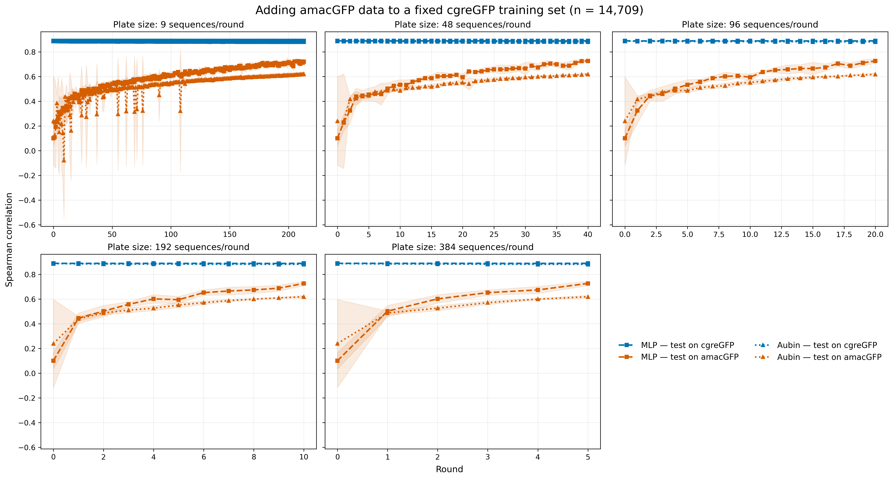
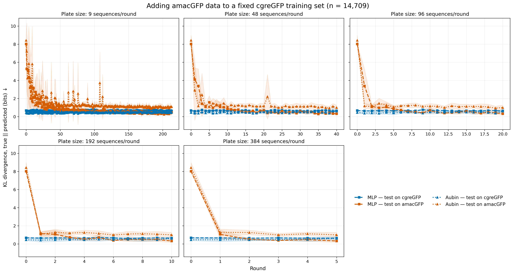
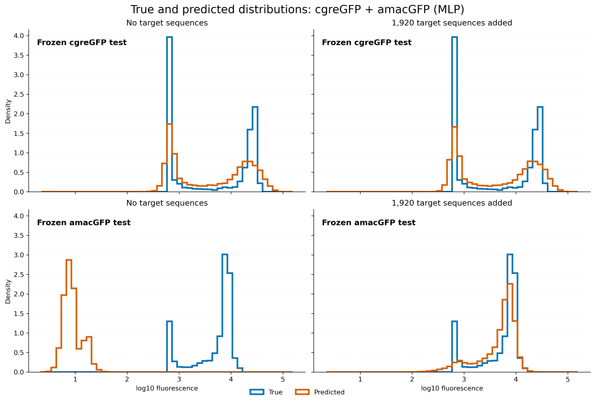
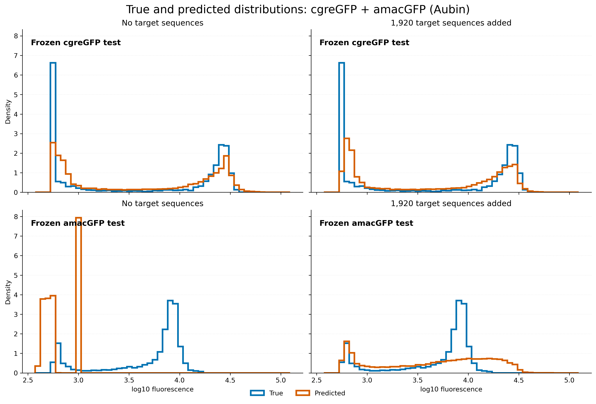

# Cross-protein labelled-pool size experiment

## Question

When a model is trained on a fixed 14,709-record cgreGFP source pool, how does gradually adding a labelled pool from ppluGFP or amacGFP change prediction on the new protein and on the original cgreGFP protein? This is a supervised pool-size experiment, not active learning: target records are added by a frozen random order, without an acquisition score.

## Design

- Fixed cgreGFP training/validation: 14,709 / 4,903 records.
- Equal target training/validation pools: 14,709 / 4,903 records.
- Plate sizes: 9, 48, 96, 192 and 384 new target training records per round.
- Schedules end near the same cumulative budget: 213 rounds × 9 = 1,917; 40 × 48 = 1,920; 20 × 96 = 1,920; 10 × 192 = 1,920; 5 × 384 = 1,920.
- The cumulative target training size is `plate size × round`; all prefixes are nested within each seed.
- Target validation grows proportionally in the original 60/20 train/validation ratio and is used only for early stopping.
- Models included in this completed result: MLP, Aubin; seeds 42–46.
- Both protein-specific test sets remain frozen and never enter training, validation, early stopping or sampling.
- R² is displayed on an ordinary linear scale limited to [−1, 1] for readability. More negative source-only target scores are clipped only in the figure; their complete values remain in the CSV tables.
- KL is D_KL(true || predicted) in bits, using 50 fixed bins over each protein's frozen-test range and a 0.5 pseudocount per bin; lower is better.

## Figures

### cgreGFP + ppluGFP

Each figure contains five panels, one for each plate size; the x-axis is round and ends when the cumulative target set reaches approximately 1,920 sequences.

True-versus-predicted frozen-test distributions before target addition and after 1,920 cumulative target training sequences; predictions are pooled across the five seeds.

#### MLP

#### Aubin

### cgreGFP + amacGFP

Each figure contains five panels, one for each plate size; the x-axis is round and ends when the cumulative target set reaches approximately 1,920 sequences.

True-versus-predicted frozen-test distributions before target addition and after 1,920 cumulative target training sequences; predictions are pooled across the five seeds.

#### MLP

#### Aubin

Machine-readable results: [summary](summary.csv) and [all seeded metrics](all_metrics.csv).
