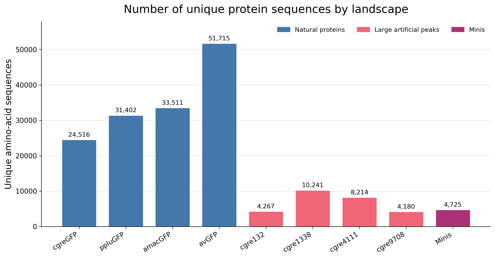

# Sequence counts by landscape

Counts are unique, valid amino-acid sequences after the canonical project filters. The four large artificial peaks are shown separately. `Minis` pools all smaller peaks from `cgre12minis` and deduplicates identical protein sequences across them. The minis source contains 4,987 retained source rows and 4,725 unique protein sequences.

Machine-readable counts: [sequence_counts.csv](sequence_counts.csv).
