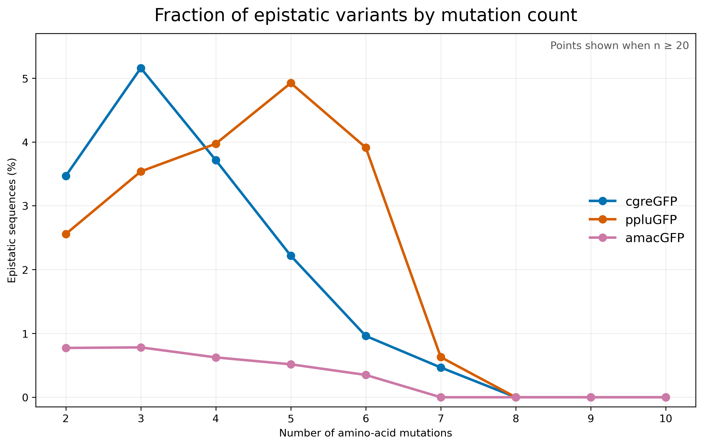
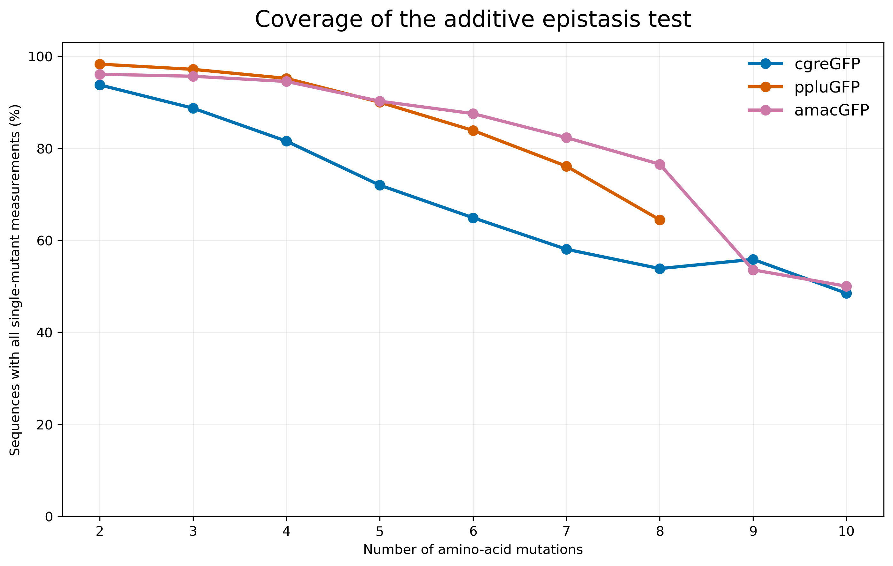

# Epistatic fraction by mutation count

The requested percentage is calculated separately for each protein and mutation count as:

`100 × number classified epistatic / total number of sequences`.

A sequence is called epistatic by the existing historical pipeline when the absolute difference between its measured wild-type-relative brightness and the sum of its constituent single-mutant effects exceeds the summed measurement uncertainties.

Some multi-mutants cannot be classified because one or more required single mutants were not measured. Following the requested denominator, these records remain in the total sequence count but not in the epistatic numerator. This makes the plotted percentage conservative, especially at high mutation counts. The coverage diagnostic shows this effect:

The main figures show mutation counts represented by at least 20 sequences. The [complete table](epistasis_by_mutation_count.csv) retains every observed count, including sparse high-mutation tails.
