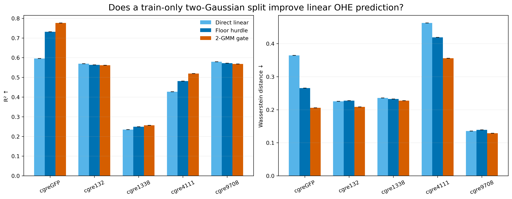

# Two-GMM-gated linear predictor

A positional one-hot sequence is passed to linear models only: logistic regression estimates `p_high`, and separate Ridge regressors predict the low and high fluorescence values. The soft output is `(1 - p_high) × low_prediction + p_high × high_prediction`. The GMM boundary and every predictor are fitted on training data only; all methods share the frozen test.

## Results

| Landscape | Direct linear R² | Floor-hurdle R² | 2-GMM-gated R² | 2-GMM-gated Pearson |
|---|---:|---:|---:|---:|
| cgreGFP | 0.596 ± 0.000 | 0.731 ± 0.000 | 0.776 ± 0.000 | 0.889 ± 0.000 |
| cgre132 | 0.569 ± 0.000 | 0.563 ± 0.000 | 0.562 ± 0.000 | 0.776 ± 0.000 |
| cgre1338 | 0.235 ± 0.000 | 0.249 ± 0.000 | 0.256 ± 0.000 | 0.508 ± 0.000 |
| cgre4111 | 0.427 ± 0.000 | 0.481 ± 0.000 | 0.519 ± 0.000 | 0.744 ± 0.000 |
| cgre9708 | 0.579 ± 0.000 | 0.572 ± 0.000 | 0.568 ± 0.000 | 0.788 ± 0.000 |

Five seeds repeat the GMM initialization. The downstream linear fits are otherwise deterministic, so identical repeated values must not be interpreted as five independent model-training replicates.

The GMM-gated construction improves R² substantially over direct linear regression for cgreGFP and cgre4111 and slightly for cgre1338. It does not help cgre132 or cgre9708. The result therefore differs from the CNN experiment: a nonlinear CNN can already learn much of the relevant sequence structure directly, whereas the probabilistic gate gives the otherwise linear sequence model a useful nonlinear low/high decomposition in some landscapes. The gated linear model is still less accurate than the direct CNN on every landscape, so it is useful as an interpretable baseline rather than a replacement for the CNN.

Machine-readable outputs: [summary](summary.csv), [all seeded metrics](all_metrics.csv), [thresholds](thresholds.csv), and [classifier metrics](classifier_metrics.csv).
