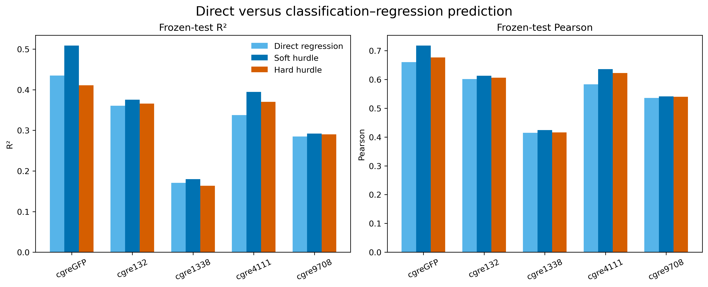

# Classification–regression predictor

All models use the same frozen 20% test records. Fitting, measurement-floor definition and feature scaling use only the remaining 80% development records. The representation is mean-pooled ESM-2 150M; the matched direct and conditional regressors are ridge models.

## Frozen-test results

| Landscape | Model | R² | Pearson | RMSE |
|---|---|---:|---:|---:|
| cgreGFP | Direct regression | 0.435 | 0.660 | 0.580 |
| cgreGFP | Soft hurdle | 0.509 | 0.717 | 0.541 |
| cgreGFP | Hard hurdle | 0.411 | 0.677 | 0.592 |
| cgre132 | Direct regression | 0.361 | 0.601 | 0.452 |
| cgre132 | Soft hurdle | 0.375 | 0.613 | 0.447 |
| cgre132 | Hard hurdle | 0.366 | 0.606 | 0.450 |
| cgre1338 | Direct regression | 0.171 | 0.415 | 0.406 |
| cgre1338 | Soft hurdle | 0.180 | 0.424 | 0.404 |
| cgre1338 | Hard hurdle | 0.164 | 0.416 | 0.408 |
| cgre4111 | Direct regression | 0.338 | 0.583 | 0.632 |
| cgre4111 | Soft hurdle | 0.394 | 0.636 | 0.604 |
| cgre4111 | Hard hurdle | 0.370 | 0.622 | 0.616 |
| cgre9708 | Direct regression | 0.285 | 0.536 | 0.374 |
| cgre9708 | Soft hurdle | 0.292 | 0.541 | 0.372 |
| cgre9708 | Hard hurdle | 0.290 | 0.539 | 0.372 |

## Measurement-floor classifier

| Landscape | ROC-AUC | Balanced accuracy | MCC | Floor prevalence in test |
|---|---:|---:|---:|---:|
| cgreGFP | 0.833 | 0.704 | 0.461 | 33.3% |
| cgre132 | 0.800 | 0.496 | -0.008 | 0.8% |
| cgre1338 | 0.546 | 0.500 | 0.001 | 9.4% |
| cgre4111 | 0.593 | 0.510 | 0.046 | 14.3% |
| cgre9708 | 0.828 | 0.499 | -0.003 | 0.8% |

## Interpretation

The soft hurdle improves R² and Pearson over matched direct regression in every landscape. The largest R² gains are cgreGFP (0.435 to 0.509) and cgre4111 (0.338 to 0.394). Hard thresholding loses information and is worse than probability-weighted prediction for every landscape.

The classifier itself is weak for cgre1338 and cgre4111, and the floor class is extremely rare for cgre132 and cgre9708. This experiment therefore supports the soft architecture, but it is not a final production predictor. The next test should place the same soft hurdle head on stronger MLP and CNN representations and compare it with their matched direct regressors.

The five seeds repeat model initialization on an identical frozen split. Ridge and logistic regression are deterministic here; the repeated identical values are retained only to match the project reporting convention and must not be interpreted as independent uncertainty estimates.

Machine-readable files: [regression summary](summary.csv) and [classifier metrics](classifier_summary.csv).
