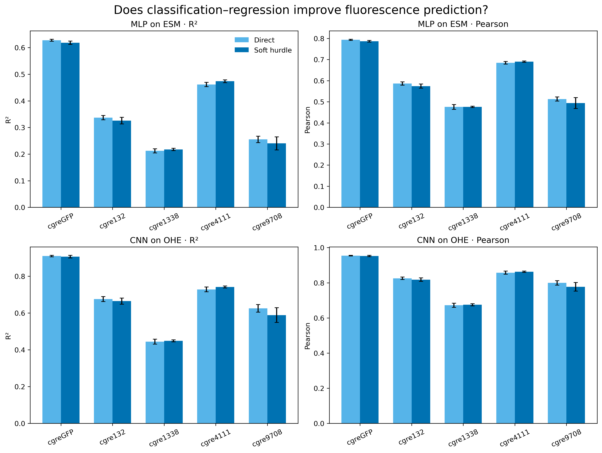

# Classification–regression models for cgreGFP landscapes

## Question

Does explicitly modelling assay-floor variants improve sequence-to-fluorescence prediction for natural cgreGFP and its four artificial-peak landscapes?

## Experimental design

Each comparison uses the same fixed 60% training, 20% validation and 20% test records. The test set is never used for fitting, threshold selection or checkpoint selection. Five independently initialized runs (seeds 42–46) are trained for every landscape and architecture.

- **Direct:** one neural network predicts log10 fluorescence.
- **Soft hurdle:** a shared network has a classification head for `measurement floor versus measurable` and a regression head fitted on measurable variants. The final prediction is a probability-weighted combination of the assay floor and conditional fluorescence.
- **MLP on ESM:** mean-pooled ESM-2 150M embeddings.
- **CNN on OHE:** native 235-residue one-hot sequence and the project's Jannis-style CNN backbone.

## Results

| Architecture | Landscape | Direct R² | Hurdle R² | ΔR² | Direct Pearson | Hurdle Pearson |
|---|---|---:|---:|---:|---:|---:|
| MLP on ESM | cgreGFP | 0.628 ± 0.004 | 0.618 ± 0.006 | -0.009 | 0.794 | 0.786 |
| MLP on ESM | cgre132 | 0.337 ± 0.008 | 0.326 ± 0.012 | -0.012 | 0.587 | 0.574 |
| MLP on ESM | cgre1338 | 0.212 ± 0.008 | 0.217 ± 0.004 | +0.005 | 0.476 | 0.476 |
| MLP on ESM | cgre4111 | 0.461 ± 0.008 | 0.474 ± 0.005 | +0.012 | 0.685 | 0.690 |
| MLP on ESM | cgre9708 | 0.255 ± 0.012 | 0.240 ± 0.025 | -0.015 | 0.513 | 0.494 |
| CNN on OHE | cgreGFP | 0.910 ± 0.004 | 0.907 ± 0.007 | -0.003 | 0.954 | 0.952 |
| CNN on OHE | cgre132 | 0.676 ± 0.014 | 0.665 ± 0.017 | -0.011 | 0.826 | 0.818 |
| CNN on OHE | cgre1338 | 0.444 ± 0.013 | 0.449 ± 0.005 | +0.005 | 0.672 | 0.675 |
| CNN on OHE | cgre4111 | 0.728 ± 0.013 | 0.741 ± 0.005 | +0.013 | 0.858 | 0.863 |
| CNN on OHE | cgre9708 | 0.625 ± 0.021 | 0.589 ± 0.040 | -0.037 | 0.799 | 0.777 |

## Decision

The hurdle architecture should be retained only where its five-seed test improvement is consistent and practically meaningful. A small classifier score alone is not evidence of a better fluorescence predictor; the decision is based on final frozen-test R², Pearson and RMSE.

## Earlier distribution analysis in plain language

A Gaussian mixture model approximates the observed fluorescence histogram with several bell-shaped curves. We compared one through four curves. **AIC** and **BIC** are fit scores that penalize adding extra curves; lower values are better. Among the tested choices, four curves described every landscape better than one or two. This does not mean that the protein has four biological states: many observations are exactly at the instrument's lower limit, which is not bell-shaped. That finding motivated the measurement-floor classifier used here.

Related evidence: [distribution analysis](../cgre_peak_mixture_analysis/REPORT.md) and [linear soft-hurdle pilot](../hurdle_esm_ridge_seed42_46/REPORT.md). Machine-readable outputs: [neural summary](summary.csv) and [classifier metrics](classifier_metrics.csv).
