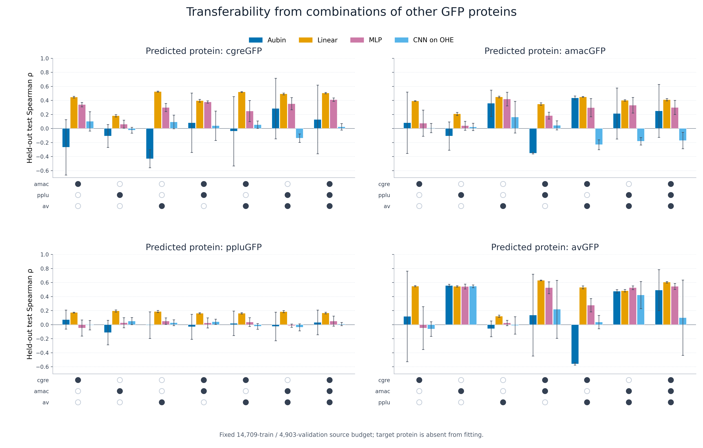
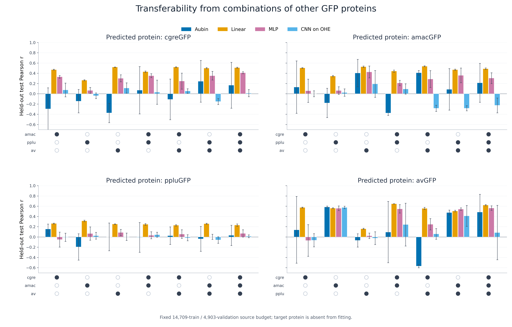
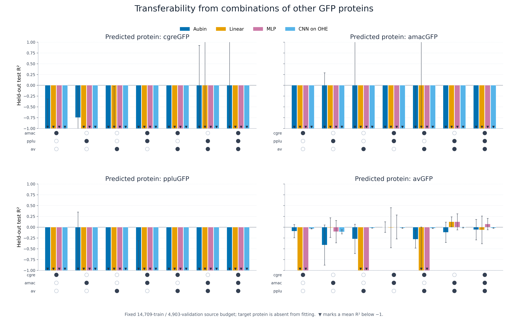

# Four-protein leave-one-out transfer

## Question

Can any one of cgreGFP, amacGFP, ppluGFP and avGFP be predicted using each possible non-empty combination of the other three proteins?

## Design

For every target, all seven source combinations are tested. Every fit uses **14,709 training** and **4,903 source-validation** records. Multiple sources contribute equally, rounded by at most one record. The target protein contributes no training or validation records. Its original 20% test split is frozen across all models, combinations and seeds.

Five seeds (42–46) vary source subsampling, initialization and training order. Checkpoints are selected only by source-validation MSE. Two cross-landscape duplicate sequences in amacGFP/avGFP are assigned to one source, and any source sequence identical to a target-test sequence is excluded.

## Reference-sequence identity

Identity is calculated from the reference proteins using global pairwise
alignment with BLOSUM62, gap-open −10 and gap-extension −0.5, matching the
transfer benchmark. The percentage is identical residues divided by total
alignment columns, including columns containing a gap.

| | cgreGFP | amacGFP | ppluGFP | avGFP |
|---|---:|---:|---:|---:|
| **cgreGFP** | 100.00% | 43.62% | 19.76% | 42.15% |
| **amacGFP** | 43.62% | 100.00% | 19.69% | 82.77% |
| **ppluGFP** | 19.76% | 19.69% | 100.00% | 20.72% |
| **avGFP** | 42.15% | 82.77% | 20.72% | 100.00% |

The machine-readable matrix is in `sequence_identity_matrix.csv`.

## Main figures

Each panel title names the held-out protein being predicted. Filled circles
below the bars identify the source proteins included in each training
combination; open circles identify proteins not included. Bar colours identify
the four predictive models.

R² uses the requested −1 to 1 display range; exact values remain in the table and CSV.

## Main findings

- Linear gives the strongest mean Spearman and Pearson result for every held-out protein. Its best Spearman values are 0.525 for cgreGFP, 0.450 for amacGFP, 0.195 for ppluGFP and 0.630 for avGFP.
- ppluGFP is the hardest target: no source combination exceeds mean Spearman 0.195.
- avGFP is the most transferable target by rank. Training Linear on cgreGFP + amacGFP gives mean Spearman 0.630 and Pearson 0.646.
- Correlation and absolute calibration answer different questions. Many fits have useful positive rank correlation but negative R², meaning that they order variants better than chance while transferring the fluorescence scale poorly. The best mean R² values are −0.746 for cgreGFP, −1.613 for amacGFP, −1.305 for ppluGFP and 0.125 for avGFP.

## Results

| Target | Sources | Model | Test n | Spearman | Pearson | R² | RMSE |
|---|---|---|---:|---:|---:|---:|---:|
| cgreGFP | amacGFP | Aubin | 4904 | -0.269 ± 0.394 | -0.295 ± 0.411 | -1.792 ± 1.474 | 1.259 ± 0.310 |
| cgreGFP | amacGFP | Linear | 4904 | 0.448 ± 0.012 | 0.471 ± 0.008 | -28.157 ± 6.432 | 4.144 ± 0.460 |
| cgreGFP | amacGFP | MLP | 4904 | 0.340 ± 0.031 | 0.331 ± 0.026 | -16.437 ± 5.775 | 3.191 ± 0.489 |
| cgreGFP | amacGFP | CNN on OHE | 4904 | 0.102 ± 0.138 | 0.074 ± 0.134 | -1.059 ± 0.059 | 1.106 ± 0.016 |
| cgreGFP | ppluGFP | Aubin | 4904 | -0.107 ± 0.162 | -0.144 ± 0.228 | -0.746 ± 0.719 | 1.004 ± 0.198 |
| cgreGFP | ppluGFP | Linear | 4904 | 0.181 ± 0.016 | 0.264 ± 0.008 | -72.399 ± 8.402 | 6.598 ± 0.388 |
| cgreGFP | ppluGFP | MLP | 4904 | 0.062 ± 0.057 | 0.065 ± 0.058 | -24.092 ± 0.736 | 3.863 ± 0.056 |
| cgreGFP | ppluGFP | CNN on OHE | 4904 | -0.025 ± 0.042 | -0.039 ± 0.056 | -1.140 ± 0.046 | 1.128 ± 0.012 |
| cgreGFP | avGFP | Aubin | 4904 | -0.431 ± 0.128 | -0.374 ± 0.188 | -7.978 ± 0.166 | 2.311 ± 0.021 |
| cgreGFP | avGFP | Linear | 4904 | 0.525 ± 0.006 | 0.521 ± 0.003 | -1.863 ± 1.838 | 1.263 ± 0.367 |
| cgreGFP | avGFP | MLP | 4904 | 0.299 ± 0.057 | 0.302 ± 0.068 | -16.201 ± 1.805 | 3.195 ± 0.165 |
| cgreGFP | avGFP | CNN on OHE | 4904 | 0.093 ± 0.097 | 0.112 ± 0.101 | -8.103 ± 0.107 | 2.327 ± 0.014 |
| cgreGFP | amacGFP+ppluGFP | Aubin | 4904 | 0.081 ± 0.423 | 0.069 ± 0.462 | -2.031 ± 0.717 | 1.335 ± 0.156 |
| cgreGFP | amacGFP+ppluGFP | Linear | 4904 | 0.395 ± 0.020 | 0.431 ± 0.014 | -16.198 ± 5.117 | 3.166 ± 0.509 |
| cgreGFP | amacGFP+ppluGFP | MLP | 4904 | 0.378 ± 0.016 | 0.353 ± 0.039 | -18.778 ± 1.892 | 3.427 ± 0.162 |
| cgreGFP | amacGFP+ppluGFP | CNN on OHE | 4904 | 0.039 ± 0.209 | 0.031 ± 0.236 | -1.108 ± 0.060 | 1.120 ± 0.016 |
| cgreGFP | amacGFP+avGFP | Aubin | 4904 | -0.040 ± 0.494 | -0.110 ± 0.397 | -6.059 ± 3.532 | 1.957 ± 0.680 |
| cgreGFP | amacGFP+avGFP | Linear | 4904 | 0.520 ± 0.006 | 0.520 ± 0.008 | -23.797 ± 6.865 | 3.805 ± 0.581 |
| cgreGFP | amacGFP+avGFP | MLP | 4904 | 0.248 ± 0.150 | 0.247 ± 0.156 | -17.522 ± 3.190 | 3.310 ± 0.281 |
| cgreGFP | amacGFP+avGFP | CNN on OHE | 4904 | 0.054 ± 0.053 | 0.054 ± 0.045 | -7.886 ± 0.382 | 2.299 ± 0.049 |
| cgreGFP | ppluGFP+avGFP | Aubin | 4904 | 0.284 ± 0.431 | 0.243 ± 0.407 | -2.870 ± 3.793 | 1.370 ± 0.728 |
| cgreGFP | ppluGFP+avGFP | Linear | 4904 | 0.492 ± 0.013 | 0.501 ± 0.010 | -5.092 ± 6.668 | 1.653 ± 1.056 |
| cgreGFP | ppluGFP+avGFP | MLP | 4904 | 0.353 ± 0.088 | 0.353 ± 0.084 | -18.182 ± 1.172 | 3.377 ± 0.103 |
| cgreGFP | ppluGFP+avGFP | CNN on OHE | 4904 | -0.139 ± 0.060 | -0.152 ± 0.058 | -8.042 ± 0.257 | 2.319 ± 0.033 |
| cgreGFP | amacGFP+ppluGFP+avGFP | Aubin | 4904 | 0.129 ± 0.489 | 0.166 ± 0.448 | -2.653 ± 3.798 | 1.336 ± 0.697 |
| cgreGFP | amacGFP+ppluGFP+avGFP | Linear | 4904 | 0.505 ± 0.009 | 0.509 ± 0.009 | -19.944 ± 3.172 | 3.521 ± 0.271 |
| cgreGFP | amacGFP+ppluGFP+avGFP | MLP | 4904 | 0.411 ± 0.024 | 0.411 ± 0.020 | -18.379 ± 1.135 | 3.394 ± 0.100 |
| cgreGFP | amacGFP+ppluGFP+avGFP | CNN on OHE | 4904 | 0.024 ± 0.046 | 0.011 ± 0.069 | -6.924 ± 0.514 | 2.170 ± 0.069 |
| amacGFP | cgreGFP | Aubin | 6703 | 0.082 ± 0.437 | 0.131 ± 0.511 | -3.499 ± 1.880 | 0.866 ± 0.194 |
| amacGFP | cgreGFP | Linear | 6703 | 0.392 ± 0.004 | 0.504 ± 0.005 | -55.550 ± 20.254 | 3.092 ± 0.552 |
| amacGFP | cgreGFP | MLP | 6703 | 0.076 ± 0.187 | 0.059 ± 0.227 | -46.158 ± 0.804 | 2.859 ± 0.024 |
| amacGFP | cgreGFP | CNN on OHE | 6703 | 0.008 ± 0.066 | 0.001 ± 0.058 | -3.838 ± 0.125 | 0.916 ± 0.012 |
| amacGFP | ppluGFP | Aubin | 6703 | -0.108 ± 0.202 | -0.179 ± 0.286 | -2.652 ± 2.941 | 0.751 ± 0.295 |
| amacGFP | ppluGFP | Linear | 6703 | 0.208 ± 0.022 | 0.346 ± 0.012 | -448.974 ± 57.862 | 8.818 ± 0.576 |
| amacGFP | ppluGFP | MLP | 6703 | 0.039 ± 0.063 | 0.062 ± 0.074 | -87.255 ± 7.969 | 3.909 ± 0.175 |
| amacGFP | ppluGFP | CNN on OHE | 6703 | 0.022 ± 0.052 | 0.024 ± 0.072 | -4.288 ± 0.157 | 0.957 ± 0.014 |
| amacGFP | avGFP | Aubin | 6703 | 0.359 ± 0.187 | 0.405 ± 0.267 | -11.830 ± 13.762 | 1.293 ± 0.831 |
| amacGFP | avGFP | Linear | 6703 | 0.448 ± 0.011 | 0.528 ± 0.014 | -2.736 ± 1.712 | 0.780 ± 0.224 |
| amacGFP | avGFP | MLP | 6703 | 0.419 ± 0.098 | 0.425 ± 0.116 | -21.435 ± 10.896 | 1.924 ± 0.486 |
| amacGFP | avGFP | CNN on OHE | 6703 | 0.162 ± 0.225 | 0.193 ± 0.261 | -28.773 ± 0.363 | 2.272 ± 0.014 |
| amacGFP | cgreGFP+ppluGFP | Aubin | 6703 | -0.353 ± 0.010 | -0.376 ± 0.047 | -1.613 ± 0.664 | 0.669 ± 0.084 |
| amacGFP | cgreGFP+ppluGFP | Linear | 6703 | 0.348 ± 0.018 | 0.442 ± 0.020 | -115.962 ± 82.818 | 4.270 ± 1.600 |
| amacGFP | cgreGFP+ppluGFP | MLP | 6703 | 0.184 ± 0.049 | 0.210 ± 0.052 | -64.579 ± 7.868 | 3.367 ± 0.209 |
| amacGFP | cgreGFP+ppluGFP | CNN on OHE | 6703 | 0.045 ± 0.066 | 0.094 ± 0.101 | -4.157 ± 0.299 | 0.945 ± 0.028 |
| amacGFP | cgreGFP+avGFP | Aubin | 6703 | 0.436 ± 0.027 | 0.409 ± 0.045 | -11.026 ± 10.997 | 1.250 ± 0.807 |
| amacGFP | cgreGFP+avGFP | Linear | 6703 | 0.450 ± 0.006 | 0.538 ± 0.009 | -6.476 ± 7.932 | 1.010 ± 0.587 |
| amacGFP | cgreGFP+avGFP | MLP | 6703 | 0.297 ± 0.129 | 0.288 ± 0.164 | -25.109 ± 14.300 | 2.046 ± 0.653 |
| amacGFP | cgreGFP+avGFP | CNN on OHE | 6703 | -0.231 ± 0.070 | -0.284 ± 0.060 | -27.496 ± 1.674 | 2.222 ± 0.065 |
| amacGFP | ppluGFP+avGFP | Aubin | 6703 | 0.214 ± 0.364 | 0.087 ± 0.404 | -21.675 ± 11.965 | 1.892 ± 0.664 |
| amacGFP | ppluGFP+avGFP | Linear | 6703 | 0.400 ± 0.010 | 0.470 ± 0.011 | -26.584 ± 18.042 | 2.072 ± 0.784 |
| amacGFP | ppluGFP+avGFP | MLP | 6703 | 0.332 ± 0.111 | 0.358 ± 0.144 | -28.084 ± 13.508 | 2.182 ± 0.592 |
| amacGFP | ppluGFP+avGFP | CNN on OHE | 6703 | -0.182 ± 0.052 | -0.283 ± 0.050 | -28.914 ± 0.784 | 2.277 ± 0.030 |
| amacGFP | cgreGFP+ppluGFP+avGFP | Aubin | 6703 | 0.250 ± 0.376 | 0.214 ± 0.380 | -14.584 ± 12.040 | 1.508 ± 0.730 |
| amacGFP | cgreGFP+ppluGFP+avGFP | Linear | 6703 | 0.410 ± 0.016 | 0.490 ± 0.015 | -25.707 ± 13.753 | 2.086 ± 0.589 |
| amacGFP | cgreGFP+ppluGFP+avGFP | MLP | 6703 | 0.300 ± 0.100 | 0.305 ± 0.106 | -33.938 ± 15.252 | 2.406 ± 0.581 |
| amacGFP | cgreGFP+ppluGFP+avGFP | CNN on OHE | 6703 | -0.172 ± 0.117 | -0.227 ± 0.145 | -25.611 ± 3.239 | 2.145 ± 0.131 |
| ppluGFP | cgreGFP | Aubin | 6281 | 0.072 ± 0.135 | 0.154 ± 0.097 | -3.682 ± 2.229 | 1.104 ± 0.281 |
| ppluGFP | cgreGFP | Linear | 6281 | 0.172 ± 0.006 | 0.263 ± 0.008 | -238.771 ± 27.309 | 8.092 ± 0.452 |
| ppluGFP | cgreGFP | MLP | 6281 | -0.048 ± 0.114 | -0.051 ± 0.145 | -45.631 ± 17.865 | 3.497 ± 0.817 |
| ppluGFP | cgreGFP | CNN on OHE | 6281 | -0.007 ± 0.067 | -0.007 ± 0.079 | -3.450 ± 0.067 | 1.104 ± 0.008 |
| ppluGFP | amacGFP | Aubin | 6281 | -0.113 ± 0.174 | -0.194 ± 0.256 | -4.815 ± 5.165 | 1.183 ± 0.491 |
| ppluGFP | amacGFP | Linear | 6281 | 0.195 ± 0.015 | 0.314 ± 0.014 | -262.871 ± 35.672 | 8.484 ± 0.572 |
| ppluGFP | amacGFP | MLP | 6281 | 0.028 ± 0.073 | 0.067 ± 0.130 | -60.661 ± 10.605 | 4.097 ± 0.342 |
| ppluGFP | amacGFP | CNN on OHE | 6281 | 0.050 ± 0.051 | 0.024 ± 0.067 | -3.579 ± 0.127 | 1.120 ± 0.015 |
| ppluGFP | avGFP | Aubin | 6281 | -0.008 ± 0.189 | 0.002 ± 0.271 | -21.394 ± 2.674 | 2.473 ± 0.148 |
| ppluGFP | avGFP | Linear | 6281 | 0.188 ± 0.016 | 0.252 ± 0.006 | -361.803 ± 51.368 | 9.947 ± 0.699 |
| ppluGFP | avGFP | MLP | 6281 | 0.050 ± 0.046 | 0.087 ± 0.062 | -59.114 ± 9.011 | 4.047 ± 0.307 |
| ppluGFP | avGFP | CNN on OHE | 6281 | 0.027 ± 0.042 | 0.004 ± 0.072 | -20.903 ± 0.258 | 2.449 ± 0.014 |
| ppluGFP | cgreGFP+amacGFP | Aubin | 6281 | -0.030 ± 0.177 | -0.008 ± 0.290 | -1.305 ± 0.991 | 0.778 ± 0.177 |
| ppluGFP | cgreGFP+amacGFP | Linear | 6281 | 0.163 ± 0.009 | 0.246 ± 0.015 | -254.073 ± 30.600 | 8.344 ± 0.506 |
| ppluGFP | cgreGFP+amacGFP | MLP | 6281 | 0.026 ± 0.072 | 0.033 ± 0.068 | -53.165 ± 1.967 | 3.850 ± 0.069 |
| ppluGFP | cgreGFP+amacGFP | CNN on OHE | 6281 | 0.041 ± 0.037 | 0.044 ± 0.048 | -3.636 ± 0.119 | 1.126 ± 0.015 |
| ppluGFP | cgreGFP+avGFP | Aubin | 6281 | 0.018 ± 0.175 | 0.025 ± 0.170 | -23.948 ± 5.446 | 2.601 ± 0.287 |
| ppluGFP | cgreGFP+avGFP | Linear | 6281 | 0.162 ± 0.010 | 0.228 ± 0.013 | -394.384 ± 91.970 | 10.354 ± 1.145 |
| ppluGFP | cgreGFP+avGFP | MLP | 6281 | 0.036 ± 0.062 | 0.056 ± 0.085 | -52.457 ± 3.146 | 3.824 ± 0.112 |
| ppluGFP | cgreGFP+avGFP | CNN on OHE | 6281 | -0.024 ± 0.040 | -0.015 ± 0.059 | -17.413 ± 1.672 | 2.243 ± 0.100 |
| ppluGFP | amacGFP+avGFP | Aubin | 6281 | -0.025 ± 0.204 | -0.038 ± 0.243 | -19.334 ± 6.087 | 2.340 ± 0.341 |
| ppluGFP | amacGFP+avGFP | Linear | 6281 | 0.185 ± 0.015 | 0.259 ± 0.009 | -411.200 ± 63.975 | 10.599 ± 0.798 |
| ppluGFP | amacGFP+avGFP | MLP | 6281 | -0.014 ± 0.024 | 0.004 ± 0.050 | -55.303 ± 2.822 | 3.925 ± 0.099 |
| ppluGFP | amacGFP+avGFP | CNN on OHE | 6281 | -0.038 ± 0.050 | -0.059 ± 0.063 | -20.975 ± 0.793 | 2.452 ± 0.044 |
| ppluGFP | cgreGFP+amacGFP+avGFP | Aubin | 6281 | 0.032 ± 0.176 | 0.032 ± 0.198 | -24.765 ± 4.115 | 2.649 ± 0.214 |
| ppluGFP | cgreGFP+amacGFP+avGFP | Linear | 6281 | 0.166 ± 0.012 | 0.232 ± 0.023 | -390.463 ± 35.100 | 10.344 ± 0.463 |
| ppluGFP | cgreGFP+amacGFP+avGFP | MLP | 6281 | 0.050 ± 0.072 | 0.069 ± 0.071 | -51.369 ± 3.593 | 3.785 ± 0.131 |
| ppluGFP | cgreGFP+amacGFP+avGFP | CNN on OHE | 6281 | 0.009 ± 0.023 | 0.014 ± 0.027 | -15.936 ± 1.143 | 2.152 ± 0.073 |
| avGFP | cgreGFP | Aubin | 10343 | 0.119 ± 0.645 | 0.139 ± 0.651 | -0.092 ± 0.152 | 1.105 ± 0.075 |
| avGFP | cgreGFP | Linear | 10343 | 0.548 ± 0.008 | 0.575 ± 0.008 | -6.442 ± 2.489 | 2.862 ± 0.460 |
| avGFP | cgreGFP | MLP | 10343 | -0.049 ± 0.305 | -0.068 ± 0.308 | -4.453 ± 0.745 | 2.470 ± 0.176 |
| avGFP | cgreGFP | CNN on OHE | 10343 | -0.063 ± 0.105 | -0.064 ± 0.129 | -0.034 ± 0.006 | 1.078 ± 0.003 |
| avGFP | amacGFP | Aubin | 10343 | 0.557 ± 0.018 | 0.585 ± 0.017 | -0.414 ± 0.466 | 1.247 ± 0.207 |
| avGFP | amacGFP | Linear | 10343 | 0.546 ± 0.010 | 0.563 ± 0.008 | -0.010 ± 0.226 | 1.060 ± 0.118 |
| avGFP | amacGFP | MLP | 10343 | 0.544 ± 0.035 | 0.560 ± 0.045 | -0.103 ± 0.257 | 1.107 ± 0.127 |
| avGFP | amacGFP | CNN on OHE | 10343 | 0.547 ± 0.019 | 0.576 ± 0.024 | -0.107 ± 0.047 | 1.115 ± 0.024 |
| avGFP | ppluGFP | Aubin | 10343 | -0.059 ± 0.113 | -0.067 ± 0.129 | -0.272 ± 0.341 | 1.188 ± 0.151 |
| avGFP | ppluGFP | Linear | 10343 | 0.121 ± 0.016 | 0.160 ± 0.011 | -42.184 ± 6.583 | 6.950 ± 0.518 |
| avGFP | ppluGFP | MLP | 10343 | 0.024 ± 0.039 | 0.023 ± 0.053 | -7.190 ± 0.753 | 3.031 ± 0.136 |
| avGFP | ppluGFP | CNN on OHE | 10343 | -0.011 ± 0.124 | -0.023 ± 0.125 | -0.019 ± 0.004 | 1.070 ± 0.002 |
| avGFP | cgreGFP+amacGFP | Aubin | 10343 | 0.137 ± 0.583 | 0.095 ± 0.597 | 0.003 ± 0.122 | 1.057 ± 0.064 |
| avGFP | cgreGFP+amacGFP | Linear | 10343 | 0.630 ± 0.005 | 0.646 ± 0.002 | -0.011 ± 0.464 | 1.046 ± 0.230 |
| avGFP | cgreGFP+amacGFP | MLP | 10343 | 0.526 ± 0.084 | 0.548 ± 0.082 | 0.006 ± 0.276 | 1.049 ± 0.146 |
| avGFP | cgreGFP+amacGFP | CNN on OHE | 10343 | 0.218 ± 0.412 | 0.241 ± 0.417 | -0.018 ± 0.009 | 1.069 ± 0.005 |
| avGFP | cgreGFP+ppluGFP | Aubin | 10343 | -0.561 ± 0.016 | -0.569 ± 0.031 | -0.279 ± 0.204 | 1.196 ± 0.092 |
| avGFP | cgreGFP+ppluGFP | Linear | 10343 | 0.532 ± 0.022 | 0.556 ± 0.020 | -7.471 ± 7.475 | 2.788 ± 1.476 |
| avGFP | cgreGFP+ppluGFP | MLP | 10343 | 0.277 ± 0.095 | 0.248 ± 0.111 | -5.704 ± 0.591 | 2.742 ± 0.123 |
| avGFP | cgreGFP+ppluGFP | CNN on OHE | 10343 | 0.037 ± 0.095 | 0.060 ± 0.103 | -0.023 ± 0.010 | 1.072 ± 0.005 |
| avGFP | amacGFP+ppluGFP | Aubin | 10343 | 0.475 ± 0.024 | 0.477 ± 0.047 | -0.119 ± 0.236 | 1.116 ± 0.115 |
| avGFP | amacGFP+ppluGFP | Linear | 10343 | 0.484 ± 0.016 | 0.507 ± 0.015 | 0.124 ± 0.116 | 0.990 ± 0.065 |
| avGFP | amacGFP+ppluGFP | MLP | 10343 | 0.526 ± 0.027 | 0.544 ± 0.024 | 0.125 ± 0.186 | 0.987 ± 0.103 |
| avGFP | amacGFP+ppluGFP | CNN on OHE | 10343 | 0.422 ± 0.193 | 0.412 ± 0.203 | -0.009 ± 0.010 | 1.065 ± 0.005 |
| avGFP | cgreGFP+amacGFP+ppluGFP | Aubin | 10343 | 0.492 ± 0.291 | 0.484 ± 0.349 | -0.057 ± 0.238 | 1.085 ± 0.118 |
| avGFP | cgreGFP+amacGFP+ppluGFP | Linear | 10343 | 0.605 ± 0.011 | 0.622 ± 0.012 | -0.063 ± 0.321 | 1.082 ± 0.172 |
| avGFP | cgreGFP+amacGFP+ppluGFP | MLP | 10343 | 0.545 ± 0.042 | 0.564 ± 0.045 | 0.073 ± 0.133 | 1.019 ± 0.072 |
| avGFP | cgreGFP+amacGFP+ppluGFP | CNN on OHE | 10343 | 0.099 ± 0.536 | 0.086 ± 0.531 | -0.019 ± 0.006 | 1.070 ± 0.003 |

Values are mean ± run SD across five seeds. `per_run_scores.csv` contains every repeat and `sample_counts.csv` preserves exact source allocations.
