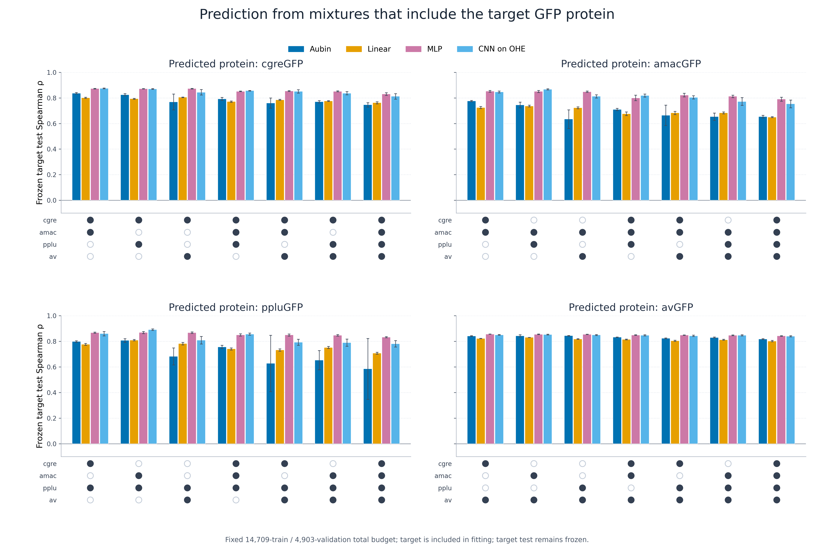
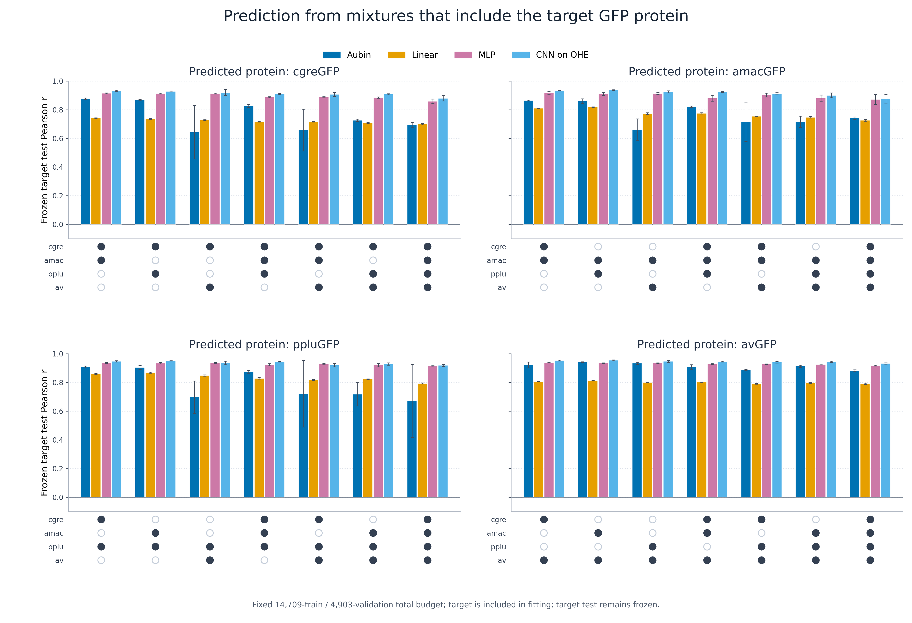
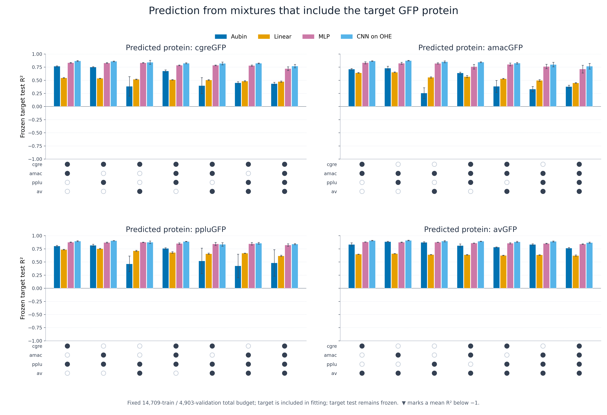

# Four-protein mixtures with the target included

## Question

How does target-protein prediction change when the target's labelled training records are combined with every non-empty combination of the other three GFP proteins?

## Design

Every fit uses a fixed total of **14,709 training** and **4,903 validation** records, divided equally among all proteins shown as filled circles. The predicted protein is always included. Its original test split remains frozen and never enters fitting or checkpoint selection.

Five seeds (42–46) vary subsampling, initialization and training order. This is the target-included counterpart to the leave-one-out experiment; the total label budget and model definitions are matched.

## Main figures

Filled circles show the proteins included in each fixed-budget training mixture. The predicted protein is filled in every column. R² is displayed from −1 to 1; exact values remain in the CSV and table.

## Main findings

- Including labelled target-protein records raises the best mean Spearman correlation from 0.525 to 0.875 for cgreGFP, 0.450 to 0.868 for amacGFP, 0.195 to 0.891 for ppluGFP, and 0.630 to 0.857 for avGFP compared with the matched leave-one-out experiment.
- CNN on OHE gives the best mean Spearman result for cgreGFP (0.875, cgreGFP + amacGFP), amacGFP (0.868, amacGFP + ppluGFP), and ppluGFP (0.891, amacGFP + ppluGFP). MLP is best for avGFP (0.857, cgreGFP + avGFP).
- Adding more source proteins does not consistently improve performance under the fixed total label budget. Two-protein mixtures are best for all four targets, because adding proteins reduces the number of labelled target sequences available to the model.

## Results

| Target | Training mixture | Model | Test n | Spearman | Pearson | R² | RMSE |
|---|---|---|---:|---:|---:|---:|---:|
| cgreGFP | cgreGFP+amacGFP | Aubin | 4904 | 0.837 ± 0.005 | 0.877 ± 0.004 | 0.765 ± 0.009 | 0.373 ± 0.007 |
| cgreGFP | cgreGFP+amacGFP | Linear | 4904 | 0.801 ± 0.005 | 0.741 ± 0.003 | 0.546 ± 0.004 | 0.520 ± 0.002 |
| cgreGFP | cgreGFP+amacGFP | MLP | 4904 | 0.873 ± 0.002 | 0.914 ± 0.003 | 0.833 ± 0.007 | 0.315 ± 0.006 |
| cgreGFP | cgreGFP+amacGFP | CNN on OHE | 4904 | 0.875 ± 0.003 | 0.933 ± 0.004 | 0.867 ± 0.010 | 0.281 ± 0.010 |
| cgreGFP | cgreGFP+ppluGFP | Aubin | 4904 | 0.825 ± 0.008 | 0.868 ± 0.006 | 0.750 ± 0.008 | 0.385 ± 0.006 |
| cgreGFP | cgreGFP+ppluGFP | Linear | 4904 | 0.793 ± 0.004 | 0.735 ± 0.003 | 0.536 ± 0.004 | 0.525 ± 0.002 |
| cgreGFP | cgreGFP+ppluGFP | MLP | 4904 | 0.871 ± 0.002 | 0.912 ± 0.003 | 0.829 ± 0.006 | 0.319 ± 0.006 |
| cgreGFP | cgreGFP+ppluGFP | CNN on OHE | 4904 | 0.870 ± 0.003 | 0.927 ± 0.003 | 0.859 ± 0.006 | 0.289 ± 0.007 |
| cgreGFP | cgreGFP+avGFP | Aubin | 4904 | 0.768 ± 0.062 | 0.644 ± 0.187 | 0.384 ± 0.185 | 0.600 ± 0.089 |
| cgreGFP | cgreGFP+avGFP | Linear | 4904 | 0.805 ± 0.002 | 0.727 ± 0.003 | 0.517 ± 0.005 | 0.536 ± 0.003 |
| cgreGFP | cgreGFP+avGFP | MLP | 4904 | 0.873 ± 0.002 | 0.913 ± 0.003 | 0.832 ± 0.004 | 0.316 ± 0.004 |
| cgreGFP | cgreGFP+avGFP | CNN on OHE | 4904 | 0.844 ± 0.021 | 0.919 ± 0.021 | 0.841 ± 0.038 | 0.306 ± 0.036 |
| cgreGFP | cgreGFP+amacGFP+ppluGFP | Aubin | 4904 | 0.793 ± 0.010 | 0.826 ± 0.010 | 0.675 ± 0.021 | 0.439 ± 0.014 |
| cgreGFP | cgreGFP+amacGFP+ppluGFP | Linear | 4904 | 0.771 ± 0.005 | 0.716 ± 0.002 | 0.509 ± 0.004 | 0.540 ± 0.002 |
| cgreGFP | cgreGFP+amacGFP+ppluGFP | MLP | 4904 | 0.852 ± 0.003 | 0.887 ± 0.004 | 0.785 ± 0.007 | 0.358 ± 0.006 |
| cgreGFP | cgreGFP+amacGFP+ppluGFP | CNN on OHE | 4904 | 0.856 ± 0.002 | 0.910 ± 0.004 | 0.824 ± 0.009 | 0.323 ± 0.008 |
| cgreGFP | cgreGFP+amacGFP+avGFP | Aubin | 4904 | 0.760 ± 0.040 | 0.658 ± 0.146 | 0.398 ± 0.152 | 0.595 ± 0.070 |
| cgreGFP | cgreGFP+amacGFP+avGFP | Linear | 4904 | 0.785 ± 0.003 | 0.716 ± 0.003 | 0.504 ± 0.008 | 0.543 ± 0.004 |
| cgreGFP | cgreGFP+amacGFP+avGFP | MLP | 4904 | 0.854 ± 0.003 | 0.887 ± 0.004 | 0.784 ± 0.007 | 0.358 ± 0.006 |
| cgreGFP | cgreGFP+amacGFP+avGFP | CNN on OHE | 4904 | 0.851 ± 0.013 | 0.907 ± 0.015 | 0.820 ± 0.026 | 0.326 ± 0.023 |
| cgreGFP | cgreGFP+ppluGFP+avGFP | Aubin | 4904 | 0.770 ± 0.009 | 0.725 ± 0.009 | 0.452 ± 0.021 | 0.571 ± 0.011 |
| cgreGFP | cgreGFP+ppluGFP+avGFP | Linear | 4904 | 0.776 ± 0.003 | 0.707 ± 0.004 | 0.484 ± 0.010 | 0.554 ± 0.006 |
| cgreGFP | cgreGFP+ppluGFP+avGFP | MLP | 4904 | 0.852 ± 0.004 | 0.885 ± 0.004 | 0.779 ± 0.011 | 0.363 ± 0.009 |
| cgreGFP | cgreGFP+ppluGFP+avGFP | CNN on OHE | 4904 | 0.837 ± 0.012 | 0.908 ± 0.004 | 0.822 ± 0.006 | 0.325 ± 0.006 |
| cgreGFP | cgreGFP+amacGFP+ppluGFP+avGFP | Aubin | 4904 | 0.746 ± 0.017 | 0.694 ± 0.019 | 0.433 ± 0.029 | 0.580 ± 0.015 |
| cgreGFP | cgreGFP+amacGFP+ppluGFP+avGFP | Linear | 4904 | 0.762 ± 0.008 | 0.700 ± 0.005 | 0.474 ± 0.011 | 0.559 ± 0.006 |
| cgreGFP | cgreGFP+amacGFP+ppluGFP+avGFP | MLP | 4904 | 0.830 ± 0.011 | 0.858 ± 0.016 | 0.722 ± 0.035 | 0.406 ± 0.025 |
| cgreGFP | cgreGFP+amacGFP+ppluGFP+avGFP | CNN on OHE | 4904 | 0.812 ± 0.021 | 0.880 ± 0.018 | 0.770 ± 0.032 | 0.369 ± 0.025 |
| amacGFP | cgreGFP+amacGFP | Aubin | 6703 | 0.776 ± 0.004 | 0.864 ± 0.003 | 0.710 ± 0.013 | 0.224 ± 0.005 |
| amacGFP | cgreGFP+amacGFP | Linear | 6703 | 0.725 ± 0.008 | 0.810 ± 0.002 | 0.641 ± 0.007 | 0.250 ± 0.002 |
| amacGFP | cgreGFP+amacGFP | MLP | 6703 | 0.852 ± 0.007 | 0.918 ± 0.009 | 0.833 ± 0.020 | 0.170 ± 0.010 |
| amacGFP | cgreGFP+amacGFP | CNN on OHE | 6703 | 0.847 ± 0.007 | 0.933 ± 0.002 | 0.867 ± 0.005 | 0.152 ± 0.003 |
| amacGFP | amacGFP+ppluGFP | Aubin | 6703 | 0.745 ± 0.022 | 0.860 ± 0.016 | 0.730 ± 0.036 | 0.216 ± 0.014 |
| amacGFP | amacGFP+ppluGFP | Linear | 6703 | 0.737 ± 0.006 | 0.819 ± 0.002 | 0.652 ± 0.006 | 0.246 ± 0.002 |
| amacGFP | amacGFP+ppluGFP | MLP | 6703 | 0.850 ± 0.008 | 0.911 ± 0.010 | 0.822 ± 0.018 | 0.175 ± 0.009 |
| amacGFP | amacGFP+ppluGFP | CNN on OHE | 6703 | 0.868 ± 0.004 | 0.938 ± 0.002 | 0.874 ± 0.005 | 0.148 ± 0.003 |
| amacGFP | amacGFP+avGFP | Aubin | 6703 | 0.634 ± 0.073 | 0.662 ± 0.075 | 0.255 ± 0.103 | 0.359 ± 0.025 |
| amacGFP | amacGFP+avGFP | Linear | 6703 | 0.723 ± 0.007 | 0.773 ± 0.005 | 0.555 ± 0.012 | 0.278 ± 0.004 |
| amacGFP | amacGFP+avGFP | MLP | 6703 | 0.849 ± 0.005 | 0.913 ± 0.007 | 0.821 ± 0.012 | 0.176 ± 0.006 |
| amacGFP | amacGFP+avGFP | CNN on OHE | 6703 | 0.812 ± 0.013 | 0.925 ± 0.008 | 0.851 ± 0.017 | 0.160 ± 0.009 |
| amacGFP | cgreGFP+amacGFP+ppluGFP | Aubin | 6703 | 0.710 ± 0.008 | 0.821 ± 0.004 | 0.637 ± 0.016 | 0.251 ± 0.006 |
| amacGFP | cgreGFP+amacGFP+ppluGFP | Linear | 6703 | 0.676 ± 0.014 | 0.775 ± 0.005 | 0.569 ± 0.020 | 0.273 ± 0.006 |
| amacGFP | cgreGFP+amacGFP+ppluGFP | MLP | 6703 | 0.800 ± 0.022 | 0.880 ± 0.020 | 0.757 ± 0.044 | 0.204 ± 0.019 |
| amacGFP | cgreGFP+amacGFP+ppluGFP | CNN on OHE | 6703 | 0.819 ± 0.011 | 0.923 ± 0.004 | 0.844 ± 0.008 | 0.165 ± 0.004 |
| amacGFP | cgreGFP+amacGFP+avGFP | Aubin | 6703 | 0.664 ± 0.080 | 0.714 ± 0.134 | 0.383 ± 0.115 | 0.326 ± 0.029 |
| amacGFP | cgreGFP+amacGFP+avGFP | Linear | 6703 | 0.683 ± 0.013 | 0.754 ± 0.002 | 0.529 ± 0.006 | 0.286 ± 0.002 |
| amacGFP | cgreGFP+amacGFP+avGFP | MLP | 6703 | 0.822 ± 0.014 | 0.903 ± 0.014 | 0.802 ± 0.027 | 0.185 ± 0.012 |
| amacGFP | cgreGFP+amacGFP+avGFP | CNN on OHE | 6703 | 0.804 ± 0.012 | 0.912 ± 0.008 | 0.825 ± 0.015 | 0.174 ± 0.008 |
| amacGFP | amacGFP+ppluGFP+avGFP | Aubin | 6703 | 0.654 ± 0.029 | 0.716 ± 0.039 | 0.331 ± 0.050 | 0.340 ± 0.013 |
| amacGFP | amacGFP+ppluGFP+avGFP | Linear | 6703 | 0.683 ± 0.008 | 0.747 ± 0.005 | 0.496 ± 0.015 | 0.296 ± 0.004 |
| amacGFP | amacGFP+ppluGFP+avGFP | MLP | 6703 | 0.812 ± 0.009 | 0.881 ± 0.021 | 0.762 ± 0.042 | 0.202 ± 0.017 |
| amacGFP | amacGFP+ppluGFP+avGFP | CNN on OHE | 6703 | 0.772 ± 0.030 | 0.900 ± 0.017 | 0.799 ± 0.042 | 0.186 ± 0.019 |
| amacGFP | cgreGFP+amacGFP+ppluGFP+avGFP | Aubin | 6703 | 0.654 ± 0.010 | 0.741 ± 0.009 | 0.380 ± 0.027 | 0.328 ± 0.007 |
| amacGFP | cgreGFP+amacGFP+ppluGFP+avGFP | Linear | 6703 | 0.649 ± 0.004 | 0.726 ± 0.006 | 0.449 ± 0.006 | 0.309 ± 0.002 |
| amacGFP | cgreGFP+amacGFP+ppluGFP+avGFP | MLP | 6703 | 0.790 ± 0.015 | 0.872 ± 0.035 | 0.713 ± 0.073 | 0.222 ± 0.028 |
| amacGFP | cgreGFP+amacGFP+ppluGFP+avGFP | CNN on OHE | 6703 | 0.754 ± 0.030 | 0.877 ± 0.030 | 0.767 ± 0.054 | 0.200 ± 0.023 |
| ppluGFP | cgreGFP+ppluGFP | Aubin | 6281 | 0.799 ± 0.006 | 0.909 ± 0.006 | 0.802 ± 0.014 | 0.233 ± 0.008 |
| ppluGFP | cgreGFP+ppluGFP | Linear | 6281 | 0.777 ± 0.008 | 0.859 ± 0.003 | 0.735 ± 0.005 | 0.269 ± 0.003 |
| ppluGFP | cgreGFP+ppluGFP | MLP | 6281 | 0.868 ± 0.005 | 0.937 ± 0.002 | 0.876 ± 0.004 | 0.184 ± 0.003 |
| ppluGFP | cgreGFP+ppluGFP | CNN on OHE | 6281 | 0.860 ± 0.016 | 0.947 ± 0.004 | 0.896 ± 0.008 | 0.169 ± 0.006 |
| ppluGFP | amacGFP+ppluGFP | Aubin | 6281 | 0.807 ± 0.014 | 0.905 ± 0.013 | 0.817 ± 0.023 | 0.224 ± 0.014 |
| ppluGFP | amacGFP+ppluGFP | Linear | 6281 | 0.810 ± 0.005 | 0.869 ± 0.003 | 0.752 ± 0.007 | 0.260 ± 0.004 |
| ppluGFP | amacGFP+ppluGFP | MLP | 6281 | 0.869 ± 0.008 | 0.935 ± 0.004 | 0.871 ± 0.008 | 0.188 ± 0.006 |
| ppluGFP | amacGFP+ppluGFP | CNN on OHE | 6281 | 0.891 ± 0.006 | 0.952 ± 0.001 | 0.905 ± 0.002 | 0.161 ± 0.002 |
| ppluGFP | ppluGFP+avGFP | Aubin | 6281 | 0.682 ± 0.066 | 0.697 ± 0.113 | 0.464 ± 0.149 | 0.380 ± 0.053 |
| ppluGFP | ppluGFP+avGFP | Linear | 6281 | 0.782 ± 0.009 | 0.850 ± 0.004 | 0.712 ± 0.011 | 0.281 ± 0.005 |
| ppluGFP | ppluGFP+avGFP | MLP | 6281 | 0.868 ± 0.006 | 0.936 ± 0.002 | 0.874 ± 0.005 | 0.186 ± 0.004 |
| ppluGFP | ppluGFP+avGFP | CNN on OHE | 6281 | 0.809 ± 0.029 | 0.937 ± 0.013 | 0.874 ± 0.024 | 0.185 ± 0.017 |
| ppluGFP | cgreGFP+amacGFP+ppluGFP | Aubin | 6281 | 0.757 ± 0.012 | 0.875 ± 0.009 | 0.757 ± 0.015 | 0.258 ± 0.008 |
| ppluGFP | cgreGFP+amacGFP+ppluGFP | Linear | 6281 | 0.741 ± 0.008 | 0.829 ± 0.005 | 0.681 ± 0.014 | 0.296 ± 0.007 |
| ppluGFP | cgreGFP+amacGFP+ppluGFP | MLP | 6281 | 0.850 ± 0.009 | 0.924 ± 0.008 | 0.850 ± 0.014 | 0.202 ± 0.009 |
| ppluGFP | cgreGFP+amacGFP+ppluGFP | CNN on OHE | 6281 | 0.857 ± 0.008 | 0.945 ± 0.001 | 0.890 ± 0.005 | 0.174 ± 0.004 |
| ppluGFP | cgreGFP+ppluGFP+avGFP | Aubin | 6281 | 0.628 ± 0.220 | 0.723 ± 0.232 | 0.520 ± 0.242 | 0.355 ± 0.081 |
| ppluGFP | cgreGFP+ppluGFP+avGFP | Linear | 6281 | 0.733 ± 0.009 | 0.818 ± 0.004 | 0.657 ± 0.013 | 0.306 ± 0.006 |
| ppluGFP | cgreGFP+ppluGFP+avGFP | MLP | 6281 | 0.850 ± 0.008 | 0.929 ± 0.005 | 0.844 ± 0.029 | 0.206 ± 0.019 |
| ppluGFP | cgreGFP+ppluGFP+avGFP | CNN on OHE | 6281 | 0.793 ± 0.024 | 0.921 ± 0.011 | 0.834 ± 0.034 | 0.212 ± 0.022 |
| ppluGFP | amacGFP+ppluGFP+avGFP | Aubin | 6281 | 0.653 ± 0.075 | 0.718 ± 0.081 | 0.425 ± 0.223 | 0.392 ± 0.071 |
| ppluGFP | amacGFP+ppluGFP+avGFP | Linear | 6281 | 0.752 ± 0.008 | 0.824 ± 0.001 | 0.667 ± 0.003 | 0.302 ± 0.001 |
| ppluGFP | amacGFP+ppluGFP+avGFP | MLP | 6281 | 0.847 ± 0.006 | 0.922 ± 0.013 | 0.846 ± 0.025 | 0.205 ± 0.016 |
| ppluGFP | amacGFP+ppluGFP+avGFP | CNN on OHE | 6281 | 0.791 ± 0.028 | 0.929 ± 0.008 | 0.857 ± 0.016 | 0.198 ± 0.011 |
| ppluGFP | cgreGFP+amacGFP+ppluGFP+avGFP | Aubin | 6281 | 0.585 ± 0.238 | 0.671 ± 0.254 | 0.482 ± 0.251 | 0.370 ± 0.081 |
| ppluGFP | cgreGFP+amacGFP+ppluGFP+avGFP | Linear | 6281 | 0.708 ± 0.007 | 0.793 ± 0.004 | 0.616 ± 0.012 | 0.324 ± 0.005 |
| ppluGFP | cgreGFP+amacGFP+ppluGFP+avGFP | MLP | 6281 | 0.833 ± 0.005 | 0.915 ± 0.006 | 0.823 ± 0.024 | 0.220 ± 0.014 |
| ppluGFP | cgreGFP+amacGFP+ppluGFP+avGFP | CNN on OHE | 6281 | 0.781 ± 0.025 | 0.919 ± 0.007 | 0.841 ± 0.011 | 0.208 ± 0.007 |
| avGFP | cgreGFP+avGFP | Aubin | 10343 | 0.842 ± 0.002 | 0.922 ± 0.021 | 0.833 ± 0.031 | 0.431 ± 0.041 |
| avGFP | cgreGFP+avGFP | Linear | 10343 | 0.822 ± 0.001 | 0.806 ± 0.001 | 0.648 ± 0.003 | 0.629 ± 0.002 |
| avGFP | cgreGFP+avGFP | MLP | 10343 | 0.857 ± 0.001 | 0.939 ± 0.001 | 0.880 ± 0.002 | 0.367 ± 0.004 |
| avGFP | cgreGFP+avGFP | CNN on OHE | 10343 | 0.851 ± 0.002 | 0.954 ± 0.003 | 0.909 ± 0.005 | 0.320 ± 0.009 |
| avGFP | amacGFP+avGFP | Aubin | 10343 | 0.843 ± 0.008 | 0.942 ± 0.003 | 0.886 ± 0.007 | 0.358 ± 0.012 |
| avGFP | amacGFP+avGFP | Linear | 10343 | 0.831 ± 0.001 | 0.813 ± 0.001 | 0.659 ± 0.003 | 0.619 ± 0.003 |
| avGFP | amacGFP+avGFP | MLP | 10343 | 0.856 ± 0.002 | 0.936 ± 0.002 | 0.875 ± 0.005 | 0.375 ± 0.007 |
| avGFP | amacGFP+avGFP | CNN on OHE | 10343 | 0.853 ± 0.003 | 0.955 ± 0.003 | 0.911 ± 0.005 | 0.316 ± 0.009 |
| avGFP | ppluGFP+avGFP | Aubin | 10343 | 0.845 ± 0.002 | 0.935 ± 0.007 | 0.872 ± 0.012 | 0.378 ± 0.018 |
| avGFP | ppluGFP+avGFP | Linear | 10343 | 0.819 ± 0.002 | 0.801 ± 0.002 | 0.640 ± 0.003 | 0.636 ± 0.003 |
| avGFP | ppluGFP+avGFP | MLP | 10343 | 0.855 ± 0.002 | 0.936 ± 0.001 | 0.875 ± 0.003 | 0.375 ± 0.004 |
| avGFP | ppluGFP+avGFP | CNN on OHE | 10343 | 0.850 ± 0.004 | 0.947 ± 0.007 | 0.896 ± 0.012 | 0.342 ± 0.020 |
| avGFP | cgreGFP+amacGFP+avGFP | Aubin | 10343 | 0.833 ± 0.002 | 0.908 ± 0.016 | 0.811 ± 0.033 | 0.459 ± 0.043 |
| avGFP | cgreGFP+amacGFP+avGFP | Linear | 10343 | 0.815 ± 0.003 | 0.802 ± 0.002 | 0.638 ± 0.006 | 0.638 ± 0.005 |
| avGFP | cgreGFP+amacGFP+avGFP | MLP | 10343 | 0.849 ± 0.002 | 0.929 ± 0.002 | 0.860 ± 0.003 | 0.397 ± 0.004 |
| avGFP | cgreGFP+amacGFP+avGFP | CNN on OHE | 10343 | 0.848 ± 0.004 | 0.946 ± 0.003 | 0.893 ± 0.005 | 0.346 ± 0.007 |
| avGFP | cgreGFP+ppluGFP+avGFP | Aubin | 10343 | 0.824 ± 0.003 | 0.889 ± 0.003 | 0.781 ± 0.008 | 0.496 ± 0.009 |
| avGFP | cgreGFP+ppluGFP+avGFP | Linear | 10343 | 0.805 ± 0.004 | 0.791 ± 0.003 | 0.625 ± 0.005 | 0.649 ± 0.004 |
| avGFP | cgreGFP+ppluGFP+avGFP | MLP | 10343 | 0.849 ± 0.002 | 0.928 ± 0.002 | 0.856 ± 0.012 | 0.402 ± 0.017 |
| avGFP | cgreGFP+ppluGFP+avGFP | CNN on OHE | 10343 | 0.844 ± 0.006 | 0.941 ± 0.006 | 0.884 ± 0.011 | 0.361 ± 0.016 |
| avGFP | amacGFP+ppluGFP+avGFP | Aubin | 10343 | 0.831 ± 0.003 | 0.914 ± 0.008 | 0.832 ± 0.015 | 0.434 ± 0.020 |
| avGFP | amacGFP+ppluGFP+avGFP | Linear | 10343 | 0.813 ± 0.003 | 0.797 ± 0.003 | 0.634 ± 0.005 | 0.641 ± 0.004 |
| avGFP | amacGFP+ppluGFP+avGFP | MLP | 10343 | 0.848 ± 0.003 | 0.926 ± 0.002 | 0.851 ± 0.005 | 0.409 ± 0.007 |
| avGFP | amacGFP+ppluGFP+avGFP | CNN on OHE | 10343 | 0.848 ± 0.004 | 0.945 ± 0.005 | 0.891 ± 0.009 | 0.350 ± 0.015 |
| avGFP | cgreGFP+amacGFP+ppluGFP+avGFP | Aubin | 10343 | 0.818 ± 0.003 | 0.882 ± 0.006 | 0.763 ± 0.015 | 0.516 ± 0.016 |
| avGFP | cgreGFP+amacGFP+ppluGFP+avGFP | Linear | 10343 | 0.803 ± 0.005 | 0.791 ± 0.005 | 0.622 ± 0.011 | 0.652 ± 0.010 |
| avGFP | cgreGFP+amacGFP+ppluGFP+avGFP | MLP | 10343 | 0.842 ± 0.002 | 0.918 ± 0.002 | 0.841 ± 0.005 | 0.422 ± 0.007 |
| avGFP | cgreGFP+amacGFP+ppluGFP+avGFP | CNN on OHE | 10343 | 0.840 ± 0.004 | 0.933 ± 0.005 | 0.867 ± 0.010 | 0.386 ± 0.015 |

Values are mean ± run SD across five seeds. `per_run_scores.csv` contains every repeat and `sample_counts.csv` preserves exact allocations.
