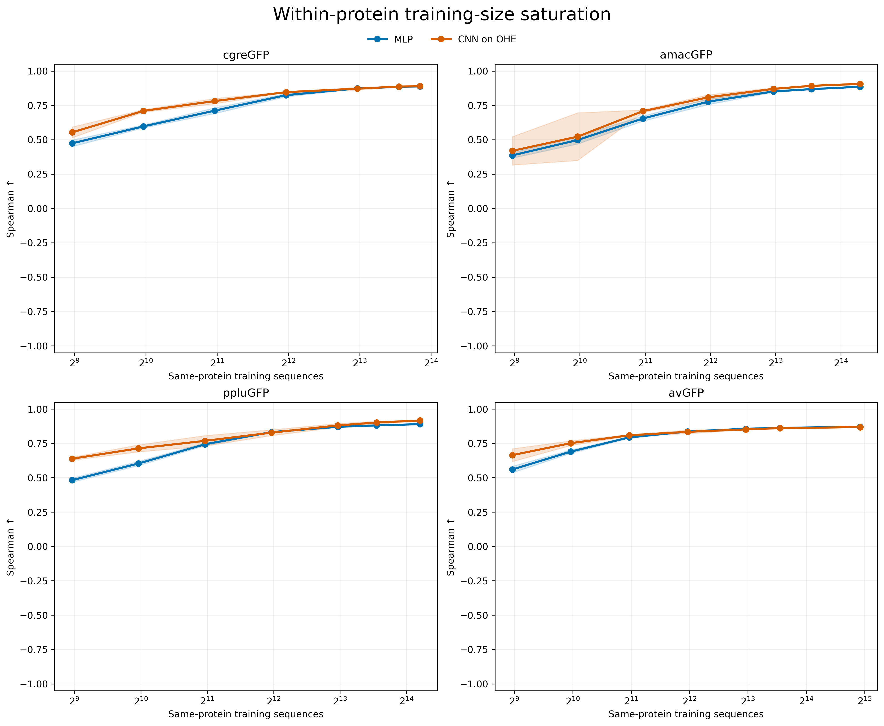
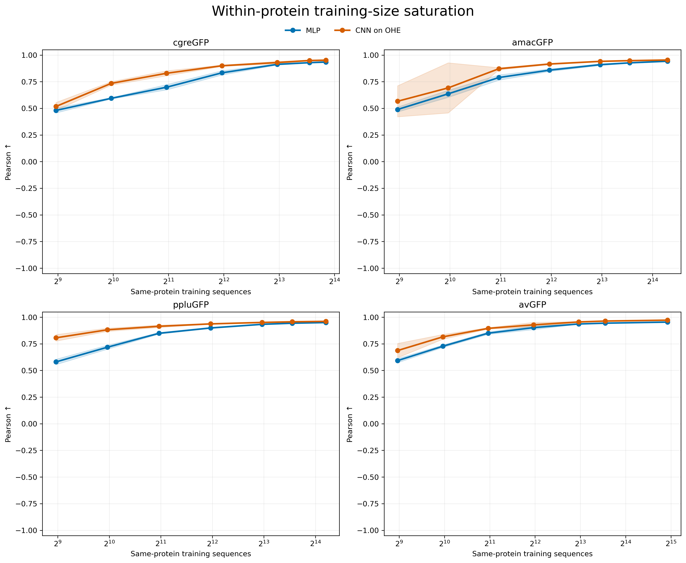
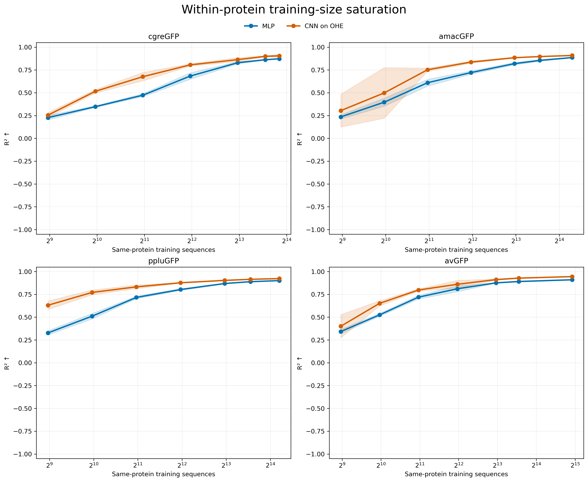
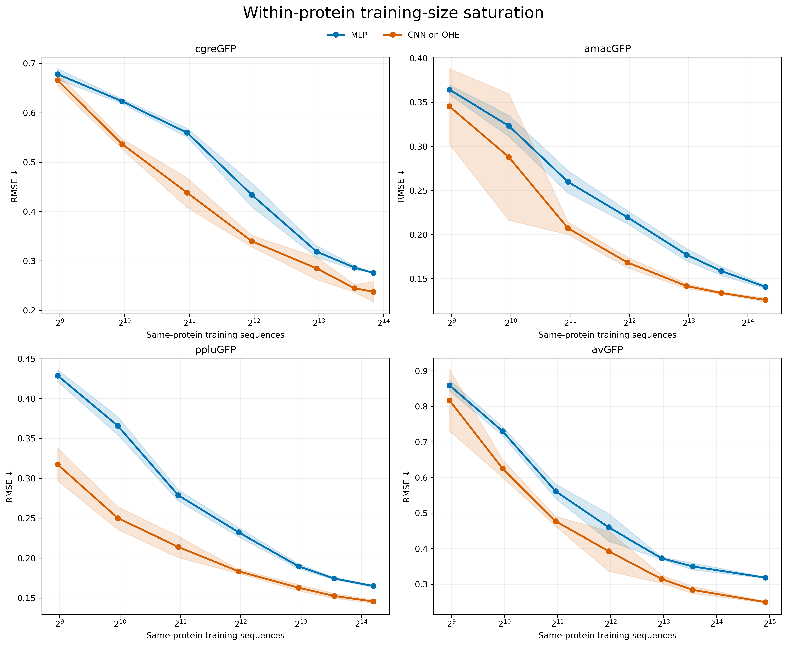
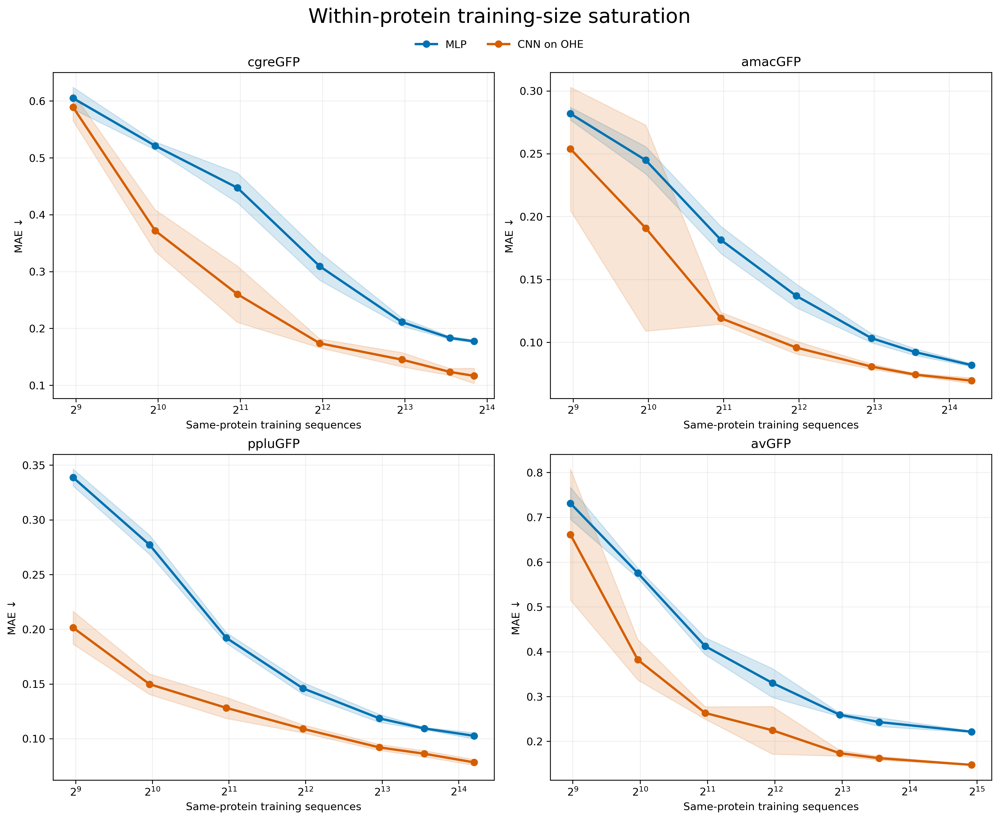
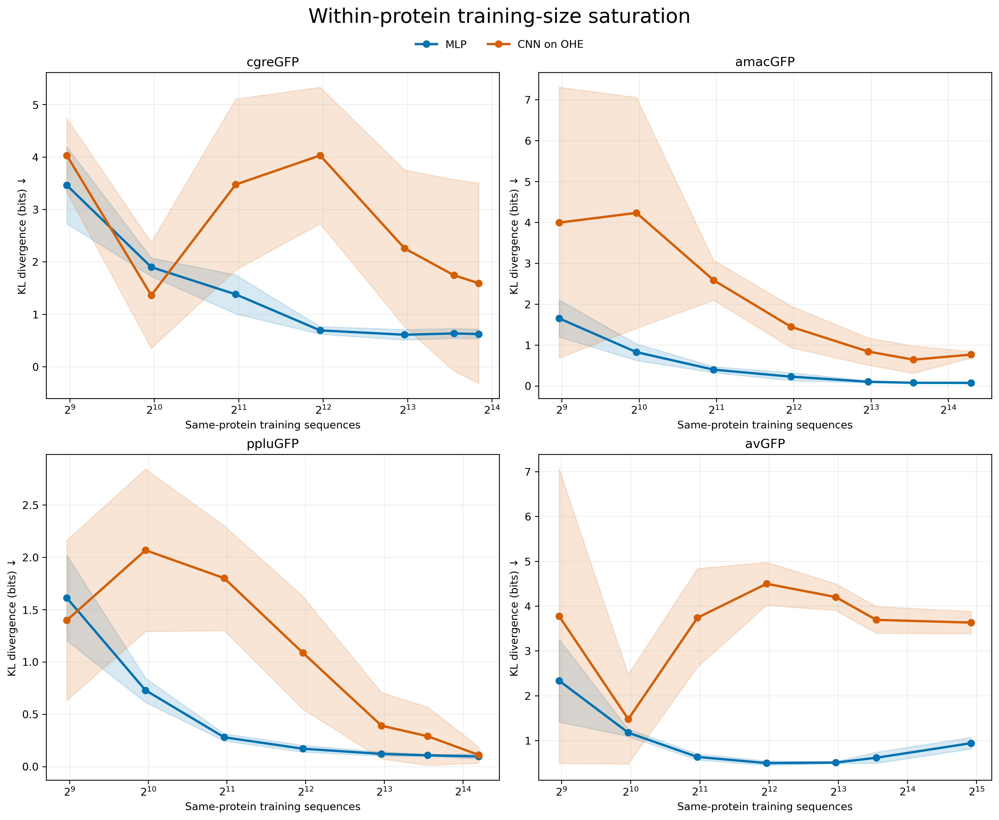
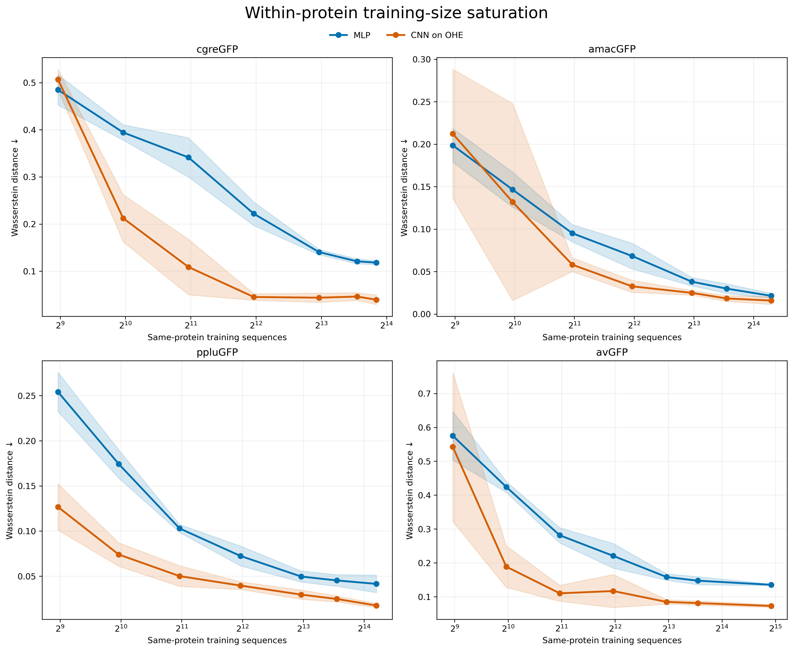

# Within-protein training-size saturation

This experiment tests whether held-out prediction stops improving as additional labelled sequences from the same protein are added. It evaluates MLP and CNN on OHE separately on cgreGFP, amacGFP, ppluGFP and avGFP.

Training subsets are nested at 500, 1,000, 2,000, 4,000, 8,000, 12,000 and the complete available training set. Five seeds change the nested order and model initialization. Each protein's original validation and test partitions remain fixed at every size.

## Figures

### Spearman ↑

### Pearson ↑

### R² ↑

### RMSE ↓

### MAE ↓

### KL divergence (bits) ↓

### Wasserstein distance ↓

## Files

[Summary](summary.csv) · [All seeded metrics](all_seeded_metrics.csv) · [Protocol](protocol.json)
