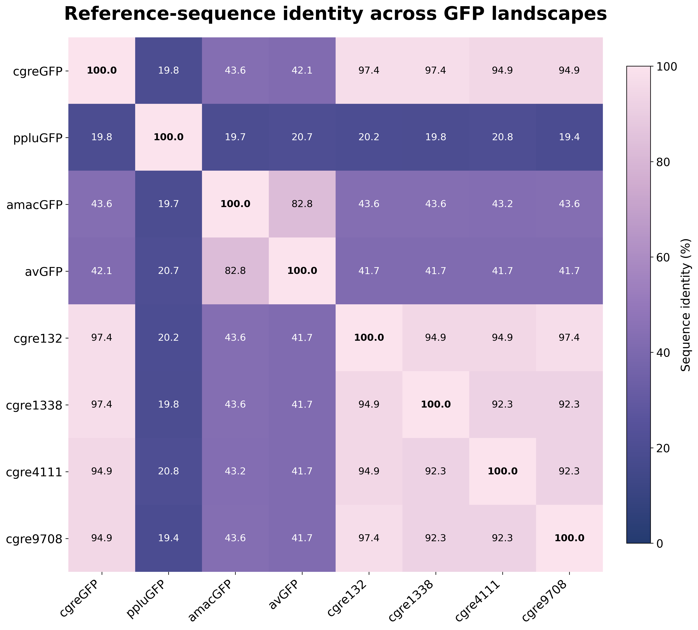
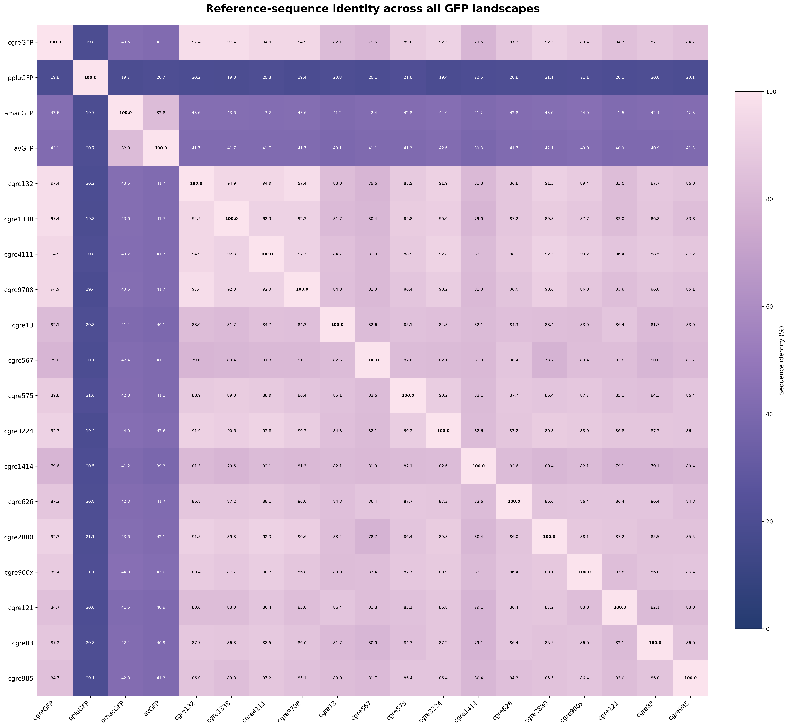

# Reference-sequence identity across GFP landscapes

Identity is calculated from reference/WT protein sequences by global pairwise alignment with BLOSUM62, gap-open −10 and gap-extension −0.5. The percentage is the number of identical residues divided by all alignment columns, including gap columns.

## Four natural proteins and four large artificial peaks

## Full matrix with Minis expanded

`Minis` is a pooled dataset category rather than one protein reference, so it has no single sequence-identity value. The full matrix therefore expands it into its 11 constituent landscape references. Machine-readable values are provided in the corresponding CSV files.
