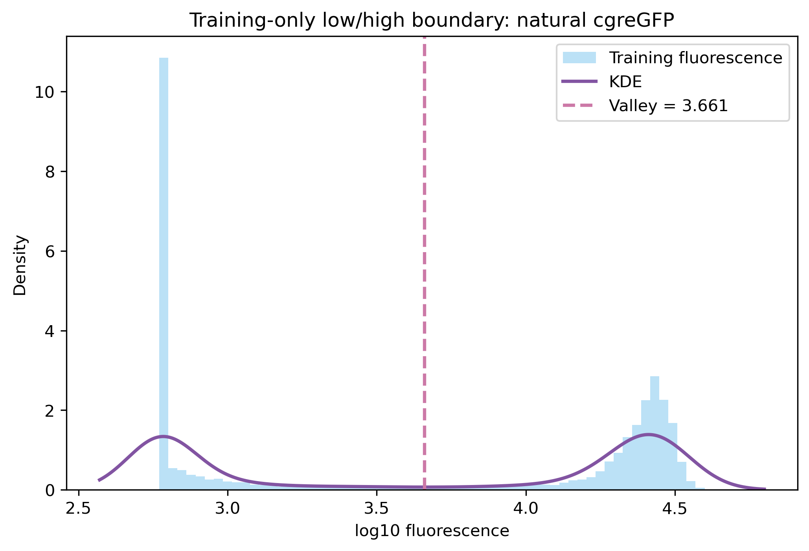

# cgreGFP: classify low/high, then regress within the selected group

Status: submitted; results pending.

Condor DAG: **121299**. Five CPU training jobs; no GPUs requested. Automatic finalization follows all five jobs.

This experiment uses four separate positional-one-hot MLPs (64 ReLU hidden neurons each): a classifier, low-group regressor, high-group regressor, and ordinary regression comparator. There is no CNN and no shared backbone. Seeds 42–46 repeat initialization and batch order on the same original 60/20/20 split (14,709 training; 4,903 validation; 4,904 test).

The threshold is the valley between the two highest prominent modes of a Scott-bandwidth Gaussian KDE fitted only to training fluorescence. It uses no Gaussian mixture. Preparation requires the valley density to be at most 80% of the smaller mode, and its threshold to vary by at most 0.15 log10 units under 0.8× and 1.2× bandwidth sensitivity checks. These are operational low/high groups, not a biologically validated functional threshold.

- **Hard routing:** p(high) ≥ 0.5 selects the high expert; otherwise selects the low expert.
- **Soft:** probability-weighted outputs of the exact same experts.
- **Direct:** ordinary MLP regression on all training records.
- **Oracle diagnostic:** true test class selects the expert. This uses privileged labels only to diagnose routing error; it is not a deployable predictor or a guaranteed upper bound.

All networks train independently. The classifier minimizes binary cross-entropy on all training sequences. Each expert minimizes MSE only within its true group; the direct regressor uses all training sequences. Validation BCE selects the classifier checkpoint; within-group validation MSE selects each expert; overall validation MSE selects direct regression. No threshold or checkpoint is selected using test data. Predictions are not clipped to class boundaries.

Training matches the small MLP recipe: Adam, learning rate 0.001, batch 32, at most 30 epochs, patience 10; original log10 fluorescence targets without normalization. Threshold and settings are frozen in [protocol.json](protocol.json). Regression/classifier diagnostics, scatter plots and overlaid distributions are generated automatically after all five seeds finish.

Reproduction: `python -m scripts.hurdle_predictor.valley_mlp prepare`, then `condor_submit_dag condor/valley_mlp.dag`. Preparation refuses to overwrite frozen settings. Per-network checkpoints support resumption. Large artifacts live in `/data/users/akolchina/gfp_project/valley_mlp_cgre_seed42_46`.
